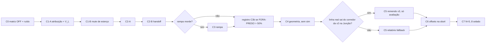

# PLANO_REALISMO_BOTS_1 — realismo dos bots do composite

**Versão:** 1.1 · **Estado:** aprovado pelo dono com 5 ajustes (rodada 2); staged, sem commit (o dono commita) · **Data:** 2026-10-29 (America/Sao_Paulo).

**Branch:** `feat/sanidade-produto`. **HEAD na redação:** `6edd4fb5acac1388d673db40b17d7243357223b5` (`6edd4fb`, closing do STAGE 6).

**Escopo da primeira entrega:** Tasks 1, 2 e 3 (este plano, o instrumento `realismo_metrics` com golden em N=0 e o prereg do C0). Depois PARE para o freeze do dono; as Tasks 4–15 começam uma etapa por vez, cada uma só após o freeze correspondente.

## 1. Problem Statement

O composite em produção (solo v10 congelado + residual `6210fff65b19ad0e`, promovido no STAGE 6) tem cinco defeitos visíveis na corrida de 10 carros:
- P1: sai da pista na reta de largada;
- P2: volta mal à pista depois de uma saída e sai de novo (cascata);
- P3: sai nas curvas abertas;
- P4: sai na Junção/Café;
- P5: forma trenzinho.

Baseline N=0 (promocao-1): Interlagos 107 contatos, 26,4% fora, 44 cruzamentos, 3 hesitações; Monaco 210 contatos, 49,9% fora, 31 cruzamentos, 5 hesitações.

A correção usa só camadas de controle e geometria: sem retreino, sem mudança de física, sem mudança do espaço de observação. Metas do programa (relatório do C7, não gate): −15% de contatos, −5 pp de tempo fora, zero saídas na largada, zero deadlocks.

## 2. Requirements

### 2.1 Ratificados na rodada 1
- R1. Banda B-1 de +10% nos contatos totais em todo ciclo de comportamento. S-1 (contatos t≤60 s sem piora) só no C1, o único ciclo que toca a largada. Nos demais ciclos, t≤60 s é só registro. Gates servem só contra regressão; melhoras passam livremente.
- R2. Realizações = seed 0 + `--variedade N`. OFF N=0 = bytes commitados da promocao-1 (nunca reexecutar). OFF N=1..4 roda uma única vez no C0 (8 corridas) e vira referência canônica. Depois, cada ciclo roda só o braço ON (mais os controles de bit-identidade da seção D2). Toda comparação é contra bytes commitados, nunca contra corridas refrescadas.
- R3. C5 usa a linha real do cache FastF1 local, zero rede. A v3 entra por seletor novo. Ponto de decisão GEOMETRIA × FALLBACK condicionado ao dado; v1 e v2 nunca editadas.
- R4. Flags novas nos dois runners, opt-in, OFF byte-idêntico. Medição: `race_diagnostic.py --profile composite`. Demo visual: `run_race_10_cars.py`.
- R5. C6 (P5) medido nos dois perfis (composite e cego v10 edge).
- R6. Plano em `backend/PLANO_REALISMO_BOTS_1.md`, staged, sem commit (o dono commita).
- R7. v1 protegida pelo hash de teste; v2 pela proveniência (corpus `c4617650…`/`af312595…` + CSVs baseline byte a byte).
- R8. O comentário do res_13 (NIT #9: o código lê Δrumo@20m/π, o comentário diz κ@10m×25) só muda em ciclo de treino; treino e inferência são consistentes.

### 2.2 Respostas desta rodada
- [1]=b. O C1 silencia só o canal de esterço do residual numa janela de largada D_L derivada no C1-A. O longitudinal do residual fica intacto. Trava de falsificação mantida.
- [2]=b. Contatos totais (B-1) e S-1 agregam por soma por pista sobre N=0..4: ΣON ≤ ceil(1,10 × ΣOFF); S-1: ΣON ≤ ΣOFF. Precisões do dono:
  - gates estruturais são por realização (qualquer corrida ON com saída na reta de largada = FAIL; critérios binários de PARE idem);
  - N=0 vira informativo para contagem, mas a tabela por realização é disclosure obrigatório em todo closing, com alerta se alguma realização explodir (ex.: ON ≥ 3× o seu OFF);
  - o σ vem do C0 na era atual; a agregação final é ratificada pelo dono no freeze do C1, com o relatório de ruído do C0 na mão.
- [3]=b. C2 = handoff com alinhamento. C3 = rampa P2 só se o teste sem simulação mostrar que ela morde (≥ 30% das reentradas relevantes).

### 2.3 Ajustes do dono (veredito: aprovado)
1. Uma só definição de contato: linhas 5 Hz com car_car > 0, calculada pelo `realismo_metrics` com golden reproduzindo 107/210 e 95/96. Números de outras eras (752/292, 292→846, 752→1520, 752→2336) entram só rotulados como "evidência qualitativa de ruído", nunca como σ.
2. C1: critério de término explícito da janela D_L no prereg (posição + velocidade, com teto 12,6 m/s) e gate R-2-T1 "sem novas saídas na entrada da T1".
3. C3b registrado como fallback futuro: se FORA-PRESO ainda dominar o tempo fora depois de C2/C3, o ciclo seguinte é perfil de velocidade na grama com gap-check, em ciclo próprio, nunca junto com outro mecanismo.
4. A v3 é só de avaliação. Promovê-la exige ciclo próprio de re-derivação das constantes em coordenadas s da v2. O mapeamento s do C4 é só para medição.
5. R-1 (laps_total ON ≥ floor(0,95 × OFF)) e R-2 (fora ON ≤ OFF + 1,0 pp em C1/C5/C6) são gates, não propostas.

### 2.4 Correção aceita pelo dono
- A8: o v10 é DAgger com rótulos do professor (`backend/model_train/train_dagger.py:7-10, 44-50`), não imitação de trajetórias reais. A linha real justifica fidelidade de pista (C5), não "a distribuição que o modelo imita".

## 3. Background — D1 achados

Os números marcados "exploratório" vieram de leituras não commitadas desta fase de planejamento. Eles servem de valor esperado; o instrumento commitado os refaz (Task 2) e divergências são reconciliadas no report.

**A1. O P1 original (g=0 com v < 2 m/s) não alcança as saídas de largada.** (exploratório, N=0)
- 9 de 10 carros passam de 2 m/s em t=0,4 s. As saídas na reta começam entre t=2,2 e 7,8 s (a maioria entre 2,2 e 3,8 s, a 7,9–12,6 m/s).
- No 1 s antes de cada saída, g médio = 1,00 e |r| = 1,5–2,1. Até t=0,6 s, carros com g=1 esterçam −0,44 a −0,78 rad; carros com g=0 esterçam +0,13 a +0,29 rad. O VER (g=0 a largada toda) não sai. O cego (mesmo solo, sem residual) tem 0 saídas na reta.
- Contagem N=0: 12 saídas na reta em Interlagos (9 carros; s 2625–2710) e 6 em Monaco (t 2,2–3,0 s), mais 2 na borda da C01 de Monaco.
- Causa provável: fileiras do grid a 9 m, abaixo do piso de 40 m de `gate_distance` (`backend/model_train/residual_gated.py:31-41`), então g=1 para todo carro com alguém à frente.
- O canal longitudinal do residual segura a largada lenta (v em t=1 s: 4,31 m/s contra 7,40 do cego). Silenciar o residual inteiro repete a ANTI-D3-1 (largada mais rápida; pós-largada 292→846 no "cc" daquela era, evidência qualitativa).

**A2. Aritmética dos gates.**
- 107 × 1,10 = 117,7 → 118. 210 × 1,10 = 231 exato. Usar aritmética inteira: em ponto flutuante `math.ceil(1.1*210)` dá 232.
- 44 e 31 são `laps_total` (cruzamentos somados nos 10 carros). 103,4 s/volta é número da era B3.1; nenhum instrumento atual calcula tempo de volta.

**A3 (retificado pelo dono). Ruído entre realizações.**
- O exemplo 752 → 2336 (VARIEDADE-1) é "cc" (soma da coluna car_car) com residual B3.1 e `--variance grid,compound`: outra métrica e outra era. Vale só como evidência qualitativa de que realizações diferem. O σ da era atual sai do C0.
- Reusar N=1..4 em vários ciclos transforma esse conjunto em conjunto de desenvolvimento. N=5..8 ficam seladas para uma confirmação única no C7.

**A4. O P2 original repete o PROF-REPAIR-1.**
- PROF-REPAIR-1 (mesma janela de 5 s, rampa a partir de 8 m/s): cascata 94,6% → 94,4%, preso +40,2 s, fora −4,46 pp (`backend/backend/ANEXO_PROF_REPAIR_1.md`).
- Composite N=0 (exploratório): a política assume no primeiro tick de volta à pista e comanda 88% (Interlagos) e 75,6% (Monaco) dos 5 s seguintes. Nova saída em ≤ 5 s: 20,3% / 42,1%. Só Interlagos mostra pulso de ritmo (9,1 → 20,2 m/s em 2 s); Monaco vai de 9,2 a 10,6 m/s.

**A5. Geometria da Junção.**
- O dado de 2024 é de chuva (58,2% das amostras da corrida e 81,3% da classificação; VSC, SC e bandeira vermelha). As corridas de 2022 e 2023 estão no cache com `position_data` e `weather_data` (`backend/cache/2022/2022-11-13_São_Paulo_Grand_Prix/2022-11-13_Race/`, `backend/cache/2023/2023-11-05_São_Paulo_Grand_Prix/2023-11-05_Race/`).
- `filter_race_line` (`backend/scripts/track_geometry_free.py`) escolhe uma única volta; mediana ponto a ponto exige código novo.
- Linha de corrida sempre tem raio maior que linha central; comparar κ das duas nunca "confirmaria" a v2. Teste justo: a linha real cabe no corredor de ±6 m da v2?
- v1 e v2 têm waypoints idênticos (sha16 `24461ba0b6c38983`), gerados por Catmull-Rom sobre ~15 marcadores de curva. O wp 634 (s 2312,5) vira −57,5° num único vértice (R≈3,2 m), ~−129° em 26 m.
- Uma v3 completa mudaria a reta e o grid. Por isso a v3 é a v2 com só o setor reprovado trocado.
- O fallback de governor como especificado não age: v_plan mínimo na Junção 41,2 km/h, margem 1,15 → freia só acima de 47,4 km/h; a mediana antes da saída é 36,8 km/h; seria preciso fator < 0,777. SAIDAS-1: 25 de 41 saídas da Junção são derrapagem.

**A6. Pontos de código afetados por uma v3.**
- Loader procura `{key}_v2.json` e depois `_v1` (`backend/domain/track_resolution.py:212-216`); hoje `--track interlagos_v3` procuraria `interlagos_v3_v2.json`.
- `_track_geometry_id` (`backend/model_train/race_diagnostic.py:251-259`) rotularia uma v3 com nome de São Paulo como `interlagos_v2`.
- `saidas_verdict.TRACKS` e constantes (`scripts/saidas_verdict.py:36-40, 55-69`) e `LAUNCH_CAP_S_CUT` (`backend/scripts/run_race_10_cars.py:609`) usam s da v2.

**A7. P5 com ±0,5 m fica abaixo de todos os limiares laterais** (mesma linha 2,6 m, corredor 3,5 m, anti-glue 2,5 m, GLUE_LAT 2,0 m). O gate do residual ignora posição lateral. Viés de esterço já dobrou a taxa de excursão no SANIDADE-1b (D4). Na era F4v15 o trenzinho era sobretudo do cego. Ponto de injeção que serve aos dois perfis: deslocar a linha central virtual só na obs4.

**A8.** Ver 2.4.

**A9 (verificado nesta sessão). FORA-PRESO domina o tempo fora.**
- Interlagos 6281/7905 = 79,5%; Monaco 11294/14963 = 75,5% (`backend/experiments/composite-1/promocao-1/1_R1_INTERLAGOS_RACE.log:69` e `3_R3_MONACO_RACE.log:69`).
- Definição (`backend/model_train/race_diagnostic.py:1762-1799`): por carro, janelas fixas de 30 s a partir de t=0; janela com alguma linha fora e (max |lat| > 20 m ou progresso de cum_dist < 5 m) conta todas as suas linhas fora como "preso"; senão "pilotagem".
- Nenhum ciclo deste plano toca o teto de 8 m/s na grama (`REJOIN_TARGET_MPS`, origem dos 25–30 km/h reclamados).

## 4. Proposed Solution

### D2 — Protocolo comum

**Realizações.**
- N=0: bytes da promocao-1 (`backend/experiments/composite-1/promocao-1/1_R1_INTERLAGOS_RACE.csv`, `3_R3_MONACO_RACE.csv` e `_events.csv`).
- N=1..4: OFF rodado uma única vez no C0.
- N=5..8: seladas até o C7 (nenhuma corrida com essas N antes). Pools de seed 76–79 intocados.
- Constantes de mecanismo derivadas só de N=0; N=1..4 servem para medir, não para ajustar.

**Comando canônico** (de `backend/`):
```
set -o pipefail; timeout --signal=TERM 2400s .venv/bin/python model_train/race_diagnostic.py --profile composite --n-cars 10 --ticks 6000 --laps 99 --track <interlagos|Monaco> --seed 0 --weather seeded --gov vplan --variance off --grid f1 --rejoin bearing --variedade <N> [flag do ciclo] --out <csv> 2>&1 | tee <log>
```
- Sem `--residual-override`. Para N=0 não passar `--variedade`.
- Cego (só C6): `--actor model_train/v10_dagger/dagger_actor_best.keras --obs-mode edge` no lugar de `--profile composite`.

**Hipótese nula caótica.** A simulação é determinística por (seed, N). Qualquer mudança de comportamento, mesmo nula em média, gera uma realização nova. A taxa de falso FAIL de cada gate é estimada com pares OFF×OFF de realizações diferentes (C0).

**Ciclo que muda código.**
- 2 controles OFF (N=0, as duas pistas) com o código do ciclo, comparados com `cmp` contra a promocao-1 (CSV e events; logs não são byte-comparáveis).
- 10 corridas ON (N=0..4 × 2 pistas).
- Uma flag por ciclo; interações só no C7.

**Instrumento.** `backend/scripts/realismo_metrics.py` (novo). Métricas canônicas vêm de `base_metrics.analyze_race` importado (SHA intocado). Métricas novas reusam funções importadas de `backend/scripts/saidas_verdict.py` e a lógica D3 do `sanidade1b_verdict.py`. Golden em N=0 antes de qualquer corrida.

**Glossário de métricas (definição única).**
- contatos = linhas 5 Hz com car_car > 0 (`contacts_5hz_total`); contatos t≤60 = as mesmas com t_s ≤ 60,0.
- fora = linhas com offtrack == 1 (|lat| > 6 m); fora% = 100 × fora / linhas.
- laps_total = cruzamentos (queda de s > 2000 m entre amostras) somados nos 10 carros.
- excursão = run contíguo de offtrack == 1 por carro (`extract_excursions`); início = 1ª linha; duração = linhas × 0,2 s.
- cascata = excursão que começa ≤ 10 s após o fim da anterior do mesmo carro (`anatomy_cascade`; wanderer > 60 s tem precedência).
- FORA-PRESO = definição de A9.
- nova saída ≤ 5 s = excursão que começa ≤ 5 s após o fim da anterior do mesmo carro.
- colado / deadlock = D3 do SANIDADE (slat = obs4 × hw; |Δlat| < 2,0 m e Δs < 5,5 m por > 2 s; deadlock = janela > 10 s).
- Zonas Z_RETA, Z_T1, C08: ver D3.
- O "cc" de eras antigas (soma da coluna car_car) não é usado.

**Integridade por corrida (falha = PARE).**
- exit 0; main CSV com 30.002 linhas físicas; `_events.csv` presente;
- log com `[diag] residual baseline sha256=6210fff65b19ad0e` exatamente uma vez e nenhuma linha `RESIDUAL OVERRIDE`;
- CSV linha 1 com o `track_frozen_sha256` esperado (`164876196eb12174` Interlagos v2; `67ca11dc211c8c78` Monaco v2);
- log com `variedade=<N>` na linha `[diag] pista FROZEN` e, para N ≥ 1, `[diag] VARIEDADE-1: N=<N>` (o CSV não registra N);
- caminhos de saída inexistentes antes da largada;
- 2 leituras do extrator com `metrics_sha256` idêntico.

**Artefatos.** `backend/experiments/realismo-1/<ciclo>/`.

**Ciclo de vida de cada etapa.** Prereg staged → freeze do dono (commit) → execução com commits de proveniência autorizados no prereg (`git add -f` dos artefatos) → EXECUCAO staged + 1 linha idêntica de ledger no fim de `backend/PROJECT_STATE.md`, `worklog.md` e `backend/model_train/AUDITORIA_RL.md` (caminhos absolutos) → closing do dono.

**Disclosure obrigatório em todo closing.** Tabela por realização (N=0..4, por pista) de todas as métricas de gate, ON × OFF. Alerta explícito (não-gate) se qualquer realização ON ≥ 3× o seu OFF em contatos, saídas ou tempo colado; decisão do dono.

### D3 — Gates

Aritmética sempre inteira. Para fora%, comparar contagens de linhas, nunca o percentual arredondado.

| Gate | Ciclos | Agregação | Regra (inteira) | Estado |
|---|---|---|---|---|
| B-1 contatos totais | C1, C2, C3, C5, C6 | soma por pista | ΣON ≤ (11·ΣOFF + 9) // 10 | ratificado |
| S-1 contatos t≤60 s | C1 | soma por pista | ΣON ≤ ΣOFF | ratificado |
| R-1 ritmo | C1, C2, C3, C5, C6 | soma por pista | ΣON ≥ (95·ΣOFF) // 100 (laps_total) | gate ratificado; agregação a ratificar no freeze do C1 |
| R-2 fora | C1, C5, C6 | taxa agregada por pista | 100·foraON ≤ 100·foraOFF + linhas (linhas iguais nos dois braços) | idem |
| C1-P1 reta de largada | C1 | por realização | toda corrida ON: 0 saídas em Z_RETA | ratificado (estrutural) |
| C1-P2 saídas t≤60 s | C1 | soma por pista | ΣON < ΣOFF | agregação a ratificar |
| R-2-T1 entrada da T1 | C1 | por realização | ∀N: ON(N) ≤ OFF(N), saídas em Z_T1 com t ≤ 60 s | gate ratificado (ajuste 2); classificação estrutural a confirmar no freeze do C1 |
| C2/C3 primário | C2, C3 | taxa agregada | foraON < foraOFF (linhas) | agregação a ratificar |
| C5 primário | C5 (Interlagos) | soma | ΣON < ΣOFF (saídas na C08) | idem |
| C6 primário | C6, nos dois perfis | colado: soma; deadlock: por realização | ΣON colado < ΣOFF; ∀N deadlocks ON(N) ≤ OFF(N) | idem |
| Integridade | todos | por corrida | D2 | PARE |

Aritmética de referência (teste obrigatório): ceil(1,10 × 107) = 118; ceil(1,10 × 210) = 231; floor(0,95 × 44) = 41; floor(0,95 × 31) = 29.

**Zonas (calculadas pelo instrumento a partir da geometria frozen com `build_corner_definitions` + `match_corner`, e conferidas com os valores abaixo):**
- Z_RETA: início de excursão com t ≤ 10 s e s ∈ [fundo do grid − 5 m, primeira fronteira de curva do match_corner à frente do grid).
  - Interlagos v2: [2608,2; 2718,3) (grid 2613,2–2649,2; C10 Senna S começa em 2748,3, margem 30 m).
  - Monaco v2: [3288,3; 3331,2) (grid 3293,3–3329,3; C01 com wrap, s0 = −4,0, sem margem no s0).
  - Contagem exploratória N=0: 12 e 6.
- Z_T1: zona da primeira curva pelo match_corner, saídas com t ≤ 60 s.
  - Interlagos: [2718,3; 2882,3] (C10 ± 30 m).
  - Monaco: [3331,2; C01.s1 + 30 m], com wrap.
- C08 Junção (Interlagos v2): [2276,2; 2344,2] ± 30 m.

**Registro C3b (não é gate).** Depois de C2/C3, se 2·preso > fora (soma por pista, definição A9) no melhor estado aprovado, fica registrado que o próximo ciclo é perfil de velocidade na grama com gap-check, em ciclo próprio.

### D4 — Ciclos

**C0 — matriz OFF e ruído (8 corridas; Tasks 2–4).**
- Entregas: instrumento com golden em N=0; prereg; 8 corridas OFF seriais (N=1..4 × Interlagos/Monaco); extração dupla; commits de proveniência autorizados; relatório de ruído; EXECUCAO staged.
- Relatório de ruído: μ̂ e σ̂ de cada métrica de gate por pista sobre N=0..4. P(falso FAIL) de cada gate sob a nula caótica:
  - gates por realização: fração dos 20 pares ordenados OFF(N')×OFF(N), N' ≠ N, que reprovariam;
  - gates por soma: aproximação normal (ΣON ~ N(5μ̂, 5σ̂²) contra o ΣOFF observado), com checagem de sanidade pelos pares.
- O dono ratifica a agregação final no freeze do C1, com esse relatório.

**C1 — largada (12 corridas; Tasks 5–6).**
- C1-A (sem simulação; N=0 das duas pistas, bytes da promocao-1):
  - Atribuição: para cada saída em Z_RETA, nas 5 linhas (1 s) anteriores ao início, calcular a contribuição do residual no esterço em espaço pré-tanh, g·r_steer. É exata: r recalculado de res_0..15 com o NPZ de produção (`backend/model_train/v15_residual/residual_best_weights.npz`, SHA16 `6210fff65b19ad0e`, via `NumpyCompositeActor.residual_forward_only`), g = g_gate.
  - Comando total aproximado: atanh(a_steer), com a_steer = steer_rad / steer_limit_rad(v) nas linhas com authority == policy (clip ±0,999; reportar quantas linhas foram clipadas). Divulgar a aproximação: a velocidade da linha é pós-passo e a ação usou a pré-passo.
  - Trava de falsificação: se a mediana (sobre as saídas) da fração g·r_steer / atanh(a_steer), no sentido da saída, for < 0,5 → PARE (o esterço do residual não explica o desvio).
  - V_L = máximo da velocidade no início das saídas em Z_RETA (duas pistas), com teto 12,6 m/s.
  - Verificar em N=0 que todo carro atinge S_L_END e V_L antes de T_L_MAX; se algum não atingir, reportar.
- C1-B: flag `--launch-steer-mute`.
  - Mecanismo: dentro da janela D_L do carro, a ação composite vira a_steer = tanh(m_solo_steer) e a_long = tanh(m_solo_long + g·r_long). Fora da janela, nada muda.
  - Janela D_L (por carro, uso único; ativa desde o tick 0): termina no primeiro tick em que (o carro atingiu S_L_END) E (v ≥ V_L), ou quando t ≥ T_L_MAX = 10 s. Depois de terminar, nunca reativa.
  - "Atingiu S_L_END" = `signed_dist_s(s, S_L_END, L) ≥ 0` (reuso de `reference_controller.signed_dist_s`), avaliado só depois do primeiro tick. Funciona nos dois runners sem depender de slots de grid.
  - S_L_END por pista (= frente do grid + margem M_L): Interlagos 2718,3 (frente 2649,2 + 69,1 m); Monaco 3331,2 (frente 3329,3 + 1,9 m). Tabela indexada pelo SHA embutido da pista frozen (`164876196eb12174`, `67ca11dc211c8c78`). SHA desconhecido com a flag ON = erro explícito (inclui a v3).
  - `_res_prev` e `_prev_actions` gravam a ação efetivamente aplicada (semântica atual); divulgar que res_14 e obs7 mudam dentro da janela.
  - Inserção: bloco composite de `backend/scripts/run_race_10_cars.py:858-924`. Com a flag OFF, a linha `a = np.tanh(m_solo + gates[:, None] * r)` (≈917) executa literalmente como hoje. `g_gate` continua nominal. Coluna `launch_steer_mute` (0/1) só existe com a flag ON (padrão de `launch_cap_active`).
  - Só com composite: `race_diagnostic.py --profile composite`; em `run_race_10_cars.py`, perfis com `residual_npz`; caso contrário, erro explícito. Em `race_diagnostic.py`, `ap.error` se combinada com `--pguard`, `--launch-stagger` ou `--launch-cap`.
  - Orçamento: 2 controles + 10 ON. Gates: C1-P1, C1-P2, R-2-T1, S-1, B-1, R-1, R-2.

**C2 — handoff do rejoin (12 corridas; Tasks 7–8).**
- C2-A (sem simulação, só N=0): mede no regime atual o ângulo de rumo na reentrada (body_x/body_y do CSV v3.4) contra nova saída em ≤ 10 s; deriva θ_H (alinhamento), m_H (margem até a borda) e T_H (teto de tempo).
- C2-B: flag `--rejoin-handoff align`. Depois da transição off→on, o esterço segue a lei de bearing (alvo = projeção + 10 m), limitado a ±steer_limit_rad(v), até |ψ_err| ≤ θ_H e |lat| ≤ hw − m_H, ou até T_H. O longitudinal continua com política + governor. Não toca o teto de 8 m/s na grama.
- Inserção depois do bloco de rejoin (`run_race_10_cars.py:1132-1168`); estado lido antes da atualização de `_was_offtrack` (linha ≈1130); precedência explícita contra `rejoin_gap`; rótulo de autoridade `rejoin_handoff` escrito a cada tick (sem o bug de rótulo grudado do `prof_repair`).
- Gates: C2/C3 primário, B-1, R-1.

**C3 — rampa P2 (0 ou 12 corridas; Task 9).**
- Teste sem simulação: a rampa morde se, em ≥ 30% das reentradas seguidas de nova saída em ≤ 10 s, a velocidade passa do teto da rampa na janela de 5 s (v_plan recalculado offline pelo `VelocityProfile` da pista, mesmos parâmetros do runner). Se não morder, o C3 não roda e isso fica registrado.
- Se rodar: flag `--rejoin-ramp`, só teto (lei de freio do governor), constantes 0,8, 8,0 m/s, 5,0 s; erro explícito sem `--gov vplan`. Gates: C2/C3 primário, B-1, R-1.
- C3b: registro de D3 (ajuste 3 do dono).

**C4 — engenharia de geometria (sem simulação; Tasks 10–11).**
- Loader: ramo explícito `_v3` em `track_resolution.load_track_frozen`, estrito, sem fallback, fora da prioridade padrão v2→v1.
- `_track_geometry_id` passa a falhar alto para v3.
- Instrumento com mapeamento s v3→v2, só para medição.
- Pipeline offline, leitura direta dos pickles (`position_data.ff1pkl`: dict de DataFrames por piloto com X/Y em decímetros, unit_scale 0,1; `fastf1` em modo offline não foi verificado, não usar):
  1. Fontes: Race 2022, 2023 e 2024 do cache local. Volta válida: Rainfall=False, bandeira verde a volta inteira, sem entrada/saída de box, não é a volta 1. N mínimo por setor pinado no prereg do C4.
  2. Registro de frame por sessão contra a v2: primeiro identidade; se não servir, Procrustes rígido; RMS > 5 m = PARE.
  3. Cada volta projetada na v2 → (s_v2, desvio lateral); mediana e IQR do desvio por bin de 2 m de s.
  4. Teste de contenção por curva: a linha real sai do corredor da v2 se |desvio mediano| > 6,0 m (critério de fora do simulador) num trecho contíguo ≥ X m (X pinado no prereg do C4).
  5. Tabela κ/raio v2 × linha real por curva (reamostragem 4 m, suavização 20 e 30 m): evidência obrigatória.
- Regra de decisão pinada antes de ler a linha real: GEOMETRIA se a linha real sai do corredor da v2 na Junção (C08 ± 30 m); senão FALLBACK. A janela de largada (fundo do grid até o fim de Z_T1) nunca é remendada.

**C5 — Junção (7 corridas ou relatório; Task 12).**
- GEOMETRIA: `interlagos_v3.json` = v2 com o setor C08 trocado pela linha real mediana, emendas suavizadas em ±20 m; `sf_idx` repinado; campos de proveniência (fonte, sessões, N de voltas, método, SHA da v2 base); sha embutido recalculado; carregável só pelo seletor `_v3`. Orçamento: 2 controles (v2 N=0, duas pistas, cmp) + 5 ON (v3, Interlagos, N=0..4). Gates: C5 primário, B-1, R-1, R-2 em Interlagos. Evidência: tabela κ/raio v2 × v3.
- FALLBACK: relatório com a aritmética do governor (A5) → o dono decide se abre ciclo próprio.
- Ajuste 4: a v3 é só de avaliação. Promovê-la exige ciclo próprio que re-derive as constantes em s da v2: `LAUNCH_CAP_S_CUT=2950` (`run_race_10_cars.py:609`), `saidas_verdict.TRACKS` e constantes, a tabela S_L_END do C1, `_track_geometry_id` e `_CORPUS_GEOMETRY_SHA256` (`race_diagnostic.py:251-265`). Interlagos está no split de treino: nenhum treino na v3 sem decisão do dono.

**C6 — trenzinho (≈32 corridas; Tasks 13–14).**
- C6-A (sem simulação): mede colado e deadlock em N=0..4 nos dois perfis (composite OFF existe após o C0; cego N=0 = `backend/experiments/composite-1/base-2/2_R2_…` e `4_R4_…`); deriva o padrão de offset por slot. Se o composite não tiver trenzinho mensurável, reportar; o dono pode reduzir o escopo.
- C6-B: flag `--lat-offset-slots`. Desloca só a obs4: `tels[i,4] = (signed − off_i)/hw`. `drv_signed`, `drv_lat`, raios e o CSV (`_obs23`) continuam físicos. |off_i| ≤ 1,0 m (margem ≥ 5,0 m até a borda). Chave por slot de grid; o runner visual também precisa setar os slots (hoje só `race_diagnostic.py` seta `_launch_grid_slots`).
- Orçamento: OFF do cego N=1..4 (8 corridas, uma vez), 4 controles (2 perfis × 2 pistas) e 20 ON. Pode ser dividido em duas etapas.
- Gates: C6 primário, B-1, R-1, R-2, cada perfil contra o próprio OFF.

**C7 — consolidação (16 corridas; +16 se o cego entrar; Task 15).**
- O conjunto das flags aprovadas roda uma única vez em N=5..8, OFF e ON, nas duas pistas. Relatório das metas do programa. Adoção = dono.

Orçamento total estimado: 87–127 corridas, ~4 min cada, serial.



### D5 — Riscos e PAREs
- S-1 não tem folga: sob a nula, uma realização reprova ~50% das vezes. A soma reduz isso; o C0 quantifica.
- C1: se o esterço do residual for o que evita contato lado a lado na largada, S-1 falha. Em Monaco a janela entra na C01 para os carros da frente até v ≥ V_L; o R-2-T1 cobre esse caso. res_14 e obs7 mudam dentro da janela.
- C2: bearing em velocidade; esterço limitado por steer_limit_rad.
- C4/C5: frames de coordenadas podem diferir entre anos; linha de corrida ≠ eixo da pista (a v3 usa a linha real como eixo no setor trocado).
- C6: obs4 deslocada sem os raios fica fora da distribuição de treino.
- PAREs: cmp de controle divergente; exit ≠ 0; extração não determinística; qualquer reexecução; orçamento estourado; leitura de shard TEST; edição de v1/v2 ou de `base_metrics.py`; corrida com N=5..8 antes do C7; divergência no golden exato; corrida sem `_events.csv` (sem contatos, o `base_metrics` não extrai: resultado preservado, decisão do dono).

## 5. Task Breakdown — D6

**Task 1: gravar o plano.**
- Objetivo: este documento v1.1 em `backend/PLANO_REALISMO_BOTS_1.md`, staged.
- Orientação: copiar integralmente as seções 1–5 (sem a seção 0, que é só para o executor); no topo, versão, data, branch, HEAD e a linha "aprovado pelo dono com 5 ajustes".
- Teste: `backend/tests/test_state_files.py` continua verde (o arquivo novo não toca os arquivos de estado).
- Demo: arquivo staged e SHA-256 reportado.

**Task 2: instrumento do C0 (TDD).**
- Arquivos: `backend/scripts/realismo_metrics.py` e `backend/tests/test_realismo_metrics.py`.
- Orientação:
  - Conferir o SHA de `base_metrics.py` antes de importar. Métricas canônicas via `base_metrics.analyze_race` importado (sem cópia).
  - Métricas novas reusando `extract_excursions`, `build_corner_definitions`, `match_corner`, `anatomy_cascade` de `backend/scripts/saidas_verdict.py` (reportar se difere da cópia da raiz) e a lógica D3 do `sanidade1b_verdict.py`. Se algo não for importável sem editar o arquivo original, reportar antes de qualquer cópia.
  - Métricas novas: excursões (total e t≤60), Z_RETA, Z_T1 (t≤60), C08, cascata (fração de eventos e de tempo fora), FORA-PRESO (réplica de `race_diagnostic.py:1774-1799`), nova saída ≤ 5 s, colado e deadlocks.
  - Zonas calculadas da geometria frozen e conferidas com os valores de D3.
  - Agregador por pista sobre N com os gates de D3 em aritmética inteira.
  - Saída JSON com criação exclusiva (nunca sobrescreve) e `metrics_sha256` canônico, no padrão do `base_metrics`. CLI `--run-id --log --main-csv --events-csv --track [--out]`.
- Testes, escritos antes do código: CSV sintético com excursões conhecidas (incluindo o wrap de Monaco nas zonas); janelas de FORA-PRESO; cascata; aritmética dos gates (107→118, 210→231, 44→41, 31→29); determinismo (duas leituras, mesmo hash).
- Golden em N=0 (promocao-1):
  - exatos, divergência = PARE: contatos 107/210; t≤60 95/96; laps 44/31; fora 26,4/49,9; hesitações 3/5; FORA-PRESO 6281/7905 e 11294/14963;
  - reconciliação obrigatória (divergência explicada no report, sem PARE): excursões 219/384; excursões t≤60 35/67; Z_RETA 12/6; cascatas 118/274; nova saída ≤ 5 s 20,3%/42,1%.
- g0: suíte completa serial; esperado 462 + k itens, com as 20 falhas canônicas idênticas (diff itemizado de `^FAILED`). Log em `backend/experiments/realismo-1/c0/0_full_suite_instrumento.log`.
- Demo: tabela golden das duas pistas e JSONs em `backend/experiments/realismo-1/c0/golden/`, staged.

**Task 3: prereg do C0, etapa A.**
- Arquivo: `backend/experiments/realismo-1/c0/PREREG_REALISMO_C0.md`, staged.
- Conteúdo:
  - cabeçalho (Versão, Estado pré-freeze, Data, Branch, HEAD, Index);
  - tabela de SHA-256: `race_diagnostic.py` (comparar com o pin `ccf9bb2c…` do BASE-2 e reportar se mudou), `run_race_10_cars.py`, `residual_gated.py`, `base_metrics.py`, `realismo_metrics.py`, `saidas_verdict.py`, NPZ de produção (`6210fff65b19ad0e51c561e332ae30fe875b5a390c389520d6e2f23cefd17c60`), `interlagos_v2.json` (`c4617650983df9b1141296dac953b0e4be03f0c06c1de006340233c39e308613`), `Monaco_v2.json` (`af3125959ade1f82062d9c9fe0dfa8020d31e431d919408ae4d293f0fac20bf2`), CSV/events da promocao-1 (valores lidos do disco);
  - §1 objetivo (matriz OFF N=1..4 + relatório de ruído; zero mudança de código de produção);
  - §2 matriz exata das 8 corridas (comando de D2 com `--variedade 1..4`; caminhos em `backend/experiments/realismo-1/c0/`; ordem serial; 30.002 linhas; checagem de pré-existência);
  - §3 integridade (D2); §4 forma canônica e regra B.1 (aborto pré-launch = quarentena + emenda do dono; reexecução = PARE); §5 pin do g0;
  - §6 extração (`realismo_metrics` e `base_metrics`, 2 leituras cada);
  - §7 método do relatório de ruído (D4/C0); §8 tabela de dados com disclosure por realização;
  - §9 commits de proveniência (mensagens propostas, a ratificar no freeze); §10 PAREs; N=5..8 seladas; pools 76–79 intocados; definições de D3; REPORT da etapa A.
- PARE: entregar ao dono para freeze. Nada roda antes do commit do dono.

**Task 4: execução do C0 (após freeze).**
- g0, 8 corridas seriais, 2 leituras por extrator, commits de proveniência autorizados, relatório de ruído, EXECUCAO staged e linhas de ledger.
- Demo: tabela OFF de N=0..4 por pista com σ̂ e P(falso FAIL) por gate.

**Task 5: C1-A + prereg do C1 → PARE.**
- Atribuição, trava, V_L, checagem de T_L_MAX, tabela S_L_END por SHA, definição do R-2-T1, contagens OFF de Z_RETA e Z_T1 por realização, proposta de agregação para ratificar.
- Teste: os números de atribuição batem com a leitura exploratória do A1, ou a divergência fica explicada.

**Task 6: implementação e corridas do C1.**
- Testes primeiro: OFF idêntico (ramo OFF executa a linha original); ON zera só a contribuição do residual no canal de esterço dentro da janela; término (as duas condições e T_L_MAX) e uso único; coluna condicional; erro com SHA de pista desconhecido; erro sem composite; exclusividade com `--pguard`, `--launch-stagger`, `--launch-cap`; flag nos dois parsers e construtores.
- Depois: 2 controles com cmp + 10 ON; veredito mecânico com os gates de D3 e disclosure por realização.
- Demo: corrida visual com `run_race_10_cars.py --profile race --launch-steer-mute`.

**Task 7: C2-A + prereg do C2 → PARE.**

**Task 8: implementação e corridas do C2** (mesmo padrão da Task 6). Demo visual com a flag.

**Task 9: teste "a rampa morde?"**, com C3 condicional (prereg → PARE → implementação → corridas) e o registro do C3b.

**Task 10: prereg do C4 com a regra de decisão pinada → PARE.**

**Task 11: engenharia do C4.**
- Teste: pins de v1/v2 inalterados (`test_track_resolution`, `test_composite_parity`, `test_loc_xy_csv`, `test_composite_corpus`, `test_composite_corpus_dump`, `test_pistas_expand` e o golden de `pistas_expand_1`); pipeline testado com círculo sintético e transformação conhecida.
- Demo: relatório de contenção e tabela κ/raio.

**Task 12: C5** (remendo v3 + 7 corridas, ou relatório de fallback).

**Task 13: C6-A + prereg do C6 → PARE.**

**Task 14: C6-B** (OFF do cego, controles e ON nos dois perfis). Demo visual com a flag.

**Task 15: C7** (confirmação selada em N=5..8 e relatório final das metas).

**Escopo desta entrega: Tasks 1 a 3, depois PARE.**
