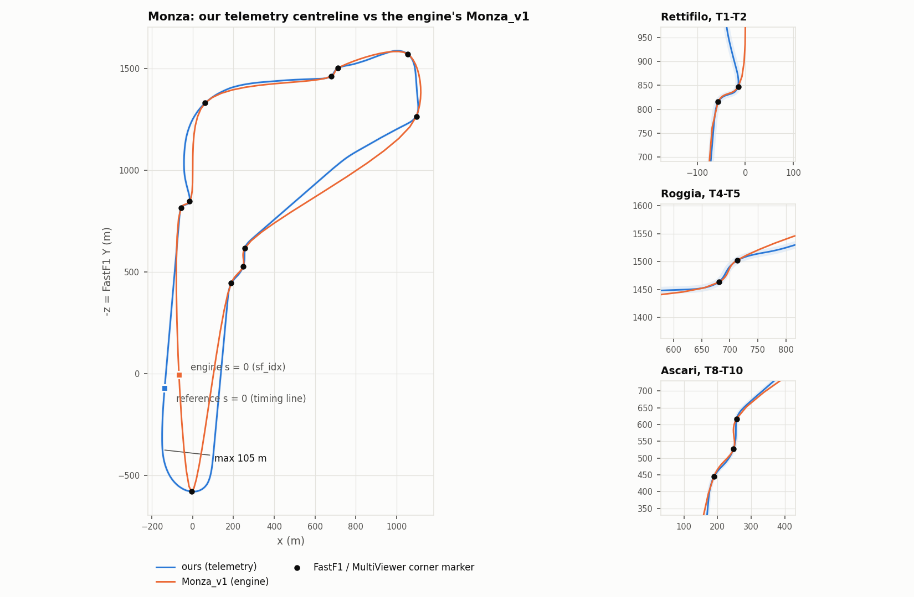
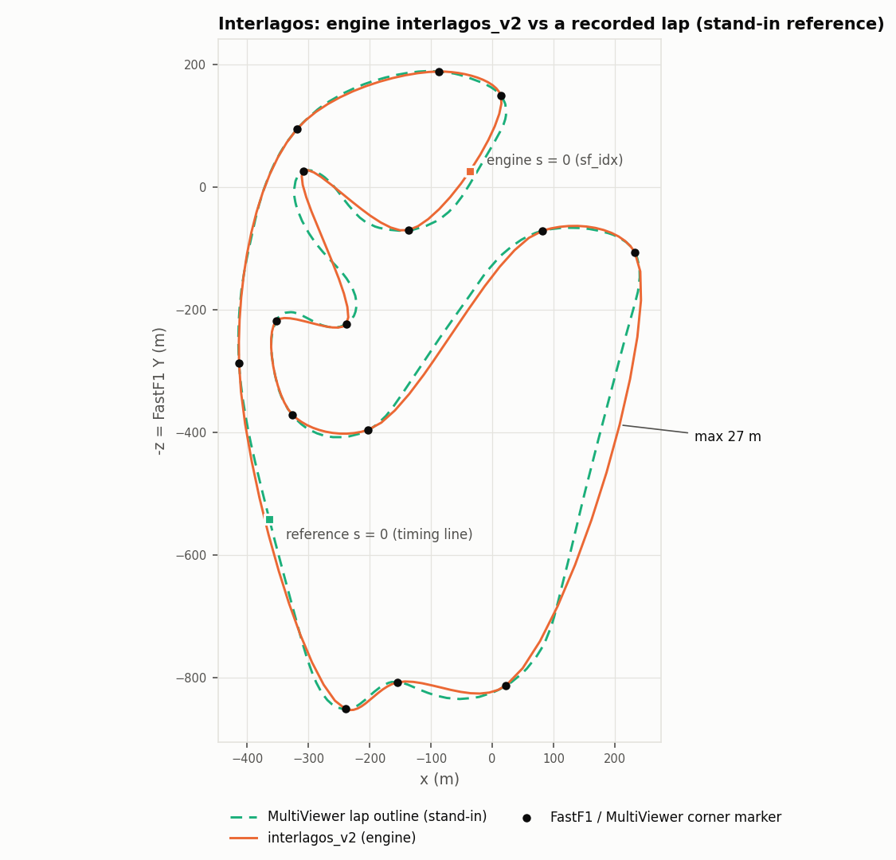
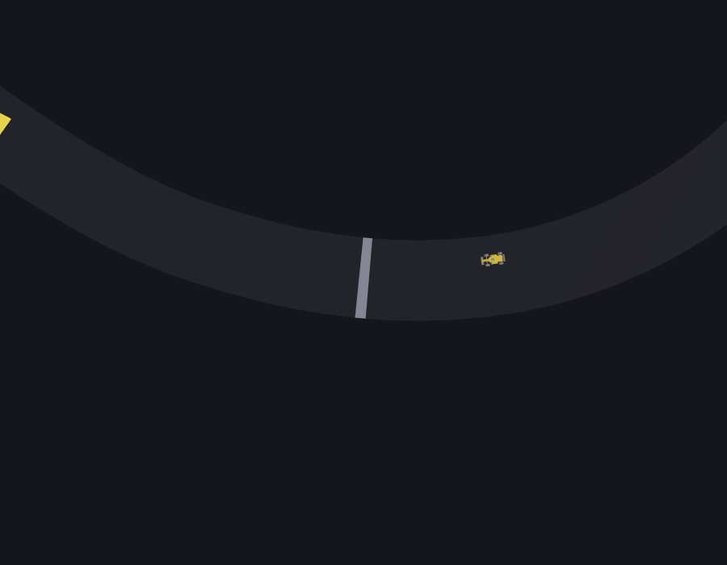
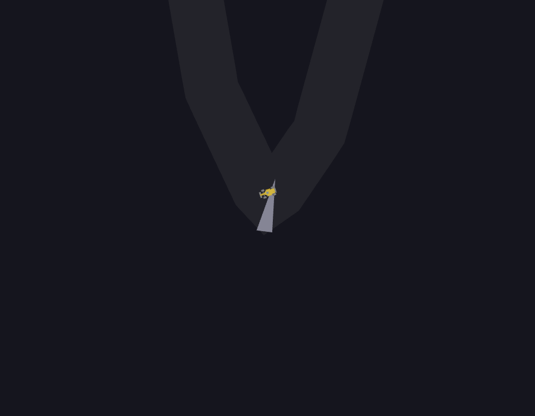

# Phase 0 — the engine's frozen tracks as the 3D geometry source

**Question.** The simulation engine (PyBullet + neural drivers, group repo branch
`feat/bot-ai`) drives on its own frozen tracks, `backend/model_train/tracks_frozen/`.
The group is leaning towards making those the single geometry source, which
means the 3D renders them instead of our telemetry centreline. This phase
produces evidence for that decision. Nothing in the group repo was modified.

**Short answer.** The frozen tracks are not a coarser version of the circuit. They
are a **spline through FastF1's corner markers**, reproduced here to 7×10⁻¹³ m.
They hit every corner marker exactly and are 20–100 m off the real circuit between
markers. Monza_v1's Hausdorff distance to our centreline is **105.5 m**. The
viewer renders them without code changes, but it renders their shape faithfully,
and that shape is not Monza.

Everything below is reproducible:

```bash
python scripts/convert_frozen_track.py --circuit monza --frozen <frozen>/Monza_v1.json \
    --corners-from public/tracks/monza.json --out public/tracks/monza_v1.json
python scripts/convert_frozen_track.py --circuit interlagos --frozen <frozen>/interlagos_v2.json \
    --corners-from-multiviewer --out public/tracks/interlagos_v2.json
python scripts/overlay_frozen.py --frozen-dir <frozen>      # -> docs/phase0/metrics.json + plots
npm test && npm run snapshot
```

`<frozen>` is `<group-repo>/backend/model_train/tracks_frozen`. Commit
`cf6529f863` is on `feat/bot-ai`, with both files clean in its working tree.

---

## 1. The frozen files, verified

| claim | verdict |
|---|---|
| `waypoints [[x, y]]` in metres, `width_m` 12.0 | ✅ |
| `sha256` | ✅ verifies on all four files inspected. It is **not** a file hash. It is the first 16 hex digits of `sha256(json.dumps(doc minus "sha256", sort_keys=True))`, as `load_track_frozen` computes it (`f1_env.py:1327`). The converter records both values. |
| waypoint 0 ≠ start/finish; `sf_idx` | ✅ Monza_v1 1268 (engine s 4819.89 m); interlagos_v2 729 (engine s 2655.16 m) |
| spacing non-uniform, max 4.0 m | ✅ Monza_v1 2.005–3.999 m, interlagos_v2 2.679–3.998 m. §3 explains why. |
| Monza_v1 = 5641.9 m | ✅ 5641.92 m |
| engine lateral is +left, ours +right | ✅ `_project_on_path` signs by `cross(segment, p − foot)` in the FastF1 (X, Y) plane, and `test_rl_v2.py:109` asserts "esquerda = positivo". So **`d_ours = −d_engine`**. Caveat: the engine measures against the **segment** normal, which is our `project_naive`, not the refined projector (§5). |
| engine uses the waypoints verbatim | ✅ `Track.from_waypoints` normalises the points and never resamples them |
| same frame as our `monza.json` | ✅ **Established.** All 11 FastF1 corner markers are vertices of Monza_v1 (§3), and a recorded lap in the FastF1 frame matches our centreline to 1.43 m (§4). The two lines differ in **shape**, not in frame. |

`interlagos_v1`, `_v2` and `_sf729_v2` share identical waypoints and the same
`sf_idx` (729). Only their metadata differs.

## 2. Conversion (`scripts/convert_frozen_track.py`)

- **Rotated, never resampled.** The loop is rolled so `sf_idx` becomes point 0, so
  `s = 0` is the engine's start/finish. The vertices are the engine's own,
  rounded to 6 decimals (micrometres). `frame.ts` does **not** assume uniform
  spacing: `s` is the cumulative chord length and segment lookup is a binary
  search. The `describe.each` seam test in `frame.test.ts` passes on both engine
  tracks at the new seam. Because nothing is resampled, the mapping is exact:
  `s_ours = (s_engine − engineSAtSfM) mod L` and `d_ours = −d_engine`. Both are
  recorded in each file's `source` block.
- `(X, Y) → (X, 0, −Y)`, asserted equal to `extract_track.to_three`.
  `widthM` 12.0 comes from the file. `year` is `null` because the file doesn't
  record one.
- **Corners.** For Monza_v1, each of our corners' points *on our centreline* is
  projected onto the frozen line with `centreline.project_global`. For
  interlagos_v2, MultiViewer's corner markers are projected (FastF1's
  `circuit_info` source; we have no Interlagos centreline, §6). Every projection
  bracketed a segment. The residual `d` on Monza_v1 is 0.29–0.72 m, which is just
  the offset of our centreline from the markers.
- **No geometric gate.** It writes the file even when reference checks fail, since
  measuring those failures is the point. It refuses only on structural problems:
  a hash mismatch, a bad `sf_idx`, a duplicated closing vertex, or non-finite
  coordinates.
- Schema: track JSON gains a required `circuit` id (`"monza"`, `"interlagos"`).
  `reference.ts` is now keyed by that id, so `Monza_v1` is checked against the
  Monza facts whatever it is called (asserted in `tracks.test.ts`). The optional
  fields added are `variant`, `uniformSpacing`, `spacingMinM`/`MaxM` and `source`.
  `monza.json` was regenerated with the parameterised extractor and is identical
  apart from the new `circuit` key.

## 3. The central finding: the frozen tracks are a spline through the corner markers

The group's `track_loader.py` builds tracks by Catmull-Rom through
`circuit_info.corners`. Four tests, each with its own output:

**(a) The markers are vertices.** All 11 MultiViewer/FastF1 corner markers are
vertices of Monza_v1 to **2.3×10⁻¹³ m**, at indices 0, 22, 153, 320, 339, 436, 523,
796, 823, 852, 1120. All 15 are vertices of interlagos_v2, to **1.1×10⁻¹³ m**.
Waypoint 0 is T1 in both, which is why "waypoint 0 is not the start/finish line".

**(b) The interpolant.** Closed Catmull-Rom through the markers, parameterised by
chord^α. Distance from every frozen vertex to the curve:

| α | Monza_v1 p50 / max (m) | interlagos_v2 p50 / max (m) |
|---|---|---|
| 0 (uniform, what `track.py::_catmull_rom_spline` on `feat/bot-ai` does) | 10.95 / 41.91 | 5.77 / 46.55 |
| 0.4 | 2.99 / 9.36 | 1.20 / 10.54 |
| **0.5 (centripetal)** | **0.20 / 2.53** | **0.15 / 1.59** |
| 0.6 | 4.01 / 13.21 | 1.60 / 12.95 |
| 1 (chordal) | 30.15 / 136.62 | 7.07 / 90.32 |

**(c) Exact reconstruction.** The ≤ 2.5 m left over at α = 0.5 is the sagitta of
straight pieces between sparse knots. The whole file is reproduced by:

1. centripetal Catmull-Rom through the markers, **12 samples per segment**,
   which is `track.py`'s `samples_per_segment` default. That gives 132 knots on
   Monza (11 × 12) and 180 on Interlagos (15 × 12);
2. each knot-to-knot chord split into **ceil(len / 4 m)** equal pieces. That is
   where the 2–4 m non-uniform spacing comes from.

Vertex for vertex: **1477/1477, max error 6.8×10⁻¹³ m** (Monza_v1) and
**1131/1131, 2.3×10⁻¹³ m** (interlagos_v2). The vertex-heading change is below
6×10⁻¹² ° at every non-knot vertex. The script that produced the files isn't on
`feat/bot-ai`, whose only Catmull-Rom is the uniform one, so this is a
reconstruction, not a citation (`overlay_frozen.py::reconstruct`).

**(d) Curvature against `s`** ([monza-curvature.png](phase0/monza-curvature.png),
[interlagos-curvature.png](phase0/interlagos-curvature.png)). The hypothesis
predicted peaks at the markers and non-zero curvature on the straights.

- **Peaks at the markers: confirmed.** On Monza_v1, 7 of 11 markers carry their
  local |κ| maximum (within ±50 m) exactly (≤ 0.2 m), T2 is within 2.6 m, and T4,
  T5 and T9 peak 7–40 m away. On interlagos_v2, 13 of 15 sit exactly. On **our**
  centreline only T4 and T10 do (within 2 m); the other nine peak 6–50 m from
  their marker, because a fitted centreline peaks at the real apex, not at an
  annotation.
- **Non-zero curvature on the straights: not as predicted.** Between knots the
  frozen line is exactly straight (κ ≈ 10⁻⁸ /m, from step 2 above). Its curvature
  is a train of spikes at the knots, which are 30 m apart at p50 and up to 166 m.
  The straights are still **not straight at the scale of the lap**. Deviation
  from the chord over our straight stretches:

| our straight (s, m) | length | ours | Monza_v1 |
|---|---|---|---|
| T11 Parabolica exit → T1 (main straight) | 1095 m | 8.1 m | **18.5 m** |
| T10 → T11 (Ascari → Parabolica) | 805 m | 0.6 m | **5.1 m** |
| Lesmo 2 → T8 Ascari | 555 m | 1.3 m | **7.0 m** |
| after Lesmo 2 | 270 m | 1.9 m | **7.9 m** |
| Curva Grande → Roggia | 290 m | 2.7 m | 1.1 m |

**(e) Kinks at the markers.** A spline forced through apex markers corners at
them. The largest single-vertex heading change is **120.4° on Monza_v1 at the T11
Parabolica marker** (s 5061.3, where |κ| reaches 0.250 /m, R 4.0 m) and **57.5° on
interlagos_v2 at T10** (R 6.7 m). Our centreline's largest is 15.9°.

## 4. Overlay — Monza ([monza-overlay.png](phase0/monza-overlay.png))



Point-to-polyline distance, both lines densified to 1 m. This is not the
projector's `d`, which assumes a nearby, well-conditioned foot point.

| | max | p50 | p90 | where the max is |
|---|---|---|---|---|
| ours → Monza_v1 | 105.49 m | 21.94 m | 74.83 m | our s 5451.8, Parabolica exit (T11 +271 m) |
| Monza_v1 → ours | 105.49 m | 19.55 m | 72.97 m | frozen s 5279.0 (T11 +218 m) |
| **Hausdorff** | **105.49 m** | | | |

- **Length.** Ours 5756.9 m, Monza_v1 5641.9 m: **−115.0 m**. Published 5793 m.
- **Corners.** Every corner is 67–120 m earlier on Monza_v1, because the shortage
  accumulates: T1 888.9 → 822.0 (−66.9 m), T3 −83.6, T4–T6 −87.4 to −88.2,
  T8–T10 −79.2 to −81.0, T11 5181.1 → 5061.3 (**−119.8 m**).
- **Start/finish.** The two `s = 0` points are **95.7 m apart**. Our s = 0 projects
  onto Monza_v1 at s **−61.3 m, d −73.5 m**. Monza_v1's s = 0 projects onto ours at
  s **+70.8 m, d +64.4 m**. The lateral component is the bowed main straight. Our
  s = 0 is the timing line: MultiViewer's timed-lap start lands at −18.0 m on it.
- **Chicanes** (zooms). Rettifilo and Roggia agree within a few metres *between*
  their two markers and diverge immediately outside them. Ascari follows the
  markers and cuts between them. The Rettifilo's left half is **not** smoothed
  away (check G passes, §7), contrary to the expectation going in.
- **Stand-in validation, used in §6.** MultiViewer's recorded lap (one 2021 FP1
  lap, 752 points, 6.8 m median step) against our centreline: **Hausdorff 1.43 m,
  p50 0.06 m, p90 0.46 m**. Against Monza_v1 it gives 105.76 m, the same picture
  as ours.

## 5. Projector preconditions on the frozen geometry

`centreline.brackets` relies on `f` being monotone on each segment, which needs
`cos α > |d κ|`. Those values were measured on our uniform 5 m Monza (cos α ≥ 0.990,
|d κ| ≤ 0.041). Re-measured:

| | min cos α | max \|d κ\| at half-width | monotone everywhere |
|---|---|---|---|
| ours | 0.990 | 0.041 | yes |
| Monza_v1 | **0.449** (at the T11 kink) | **1.498** | **no** |
| interlagos_v2 | 0.855 | 0.894 | **no** (T10) |

The corner projections above all bracketed: the lowest cos α at a projected corner
was 0.547 (T11). But "(s, d) ↔ world is an identity" (3d-design §6B) no longer
holds unconditionally at the kinks. The engine's own lateral is measured against
the segment normal, and on these files that differs from the interpolated-tangent
normal by up to acos(0.449) = 63° at Parabolica. So near a kink, `d_engine` and
our `d` are not just sign-flipped copies of each other.

## 6. Interlagos ([interlagos-overlay.png](phase0/interlagos-overlay.png))



**Our São Paulo extraction is blocked, not tuned.** `extract_track.py` is now
parameterised by circuit (references only; every pipeline parameter is
unchanged, and the window stays 43 m via `--n-resample 1500`). But **F1's
live-timing archive answers HTTP 401** to every unauthenticated request. That
includes the Monza 2024 URLs: our `monza.json` still builds only because
`.fastf1-cache/` holds that session, downloaded 2026-09-18, both as FastF1
pickles and as raw HTTP responses in `fastf1_http_cache.sqlite`. That cache
contains **no São Paulo session**, and no other FastF1 cache exists on this
machine (the group repo's included). So there is **no Interlagos telemetry
centreline of ours**.

Retried on 2026-11-05 with the **latest FastF1, 3.9.2** (in place of the
pinned 3.4.4), against an empty cache, for both Monza 2024 and São Paulo 2024
Race. It is still blocked; only the failure mode differs:

- 3.9.2 first tries to sign in to an F1 account and logs: `Failed to
  authenticate with Formula 1 account, continuing without authentication: No
  F1 account credentials available. Set the environment variables F1_USERNAME
  and F1_PASSWORD.`
- `livetiming.formula1.com/static/2024/…/SessionInfo.jsonStream` (and every
  other feed) then returns `requests.exceptions.HTTPError: 401 Client Error:
  Unauthorized`.
- 3.9.2 falls back to its own mirror, `livetiming-mirror.fastf1.dev`, which
  returns **HTTP 404** for both sessions. FastF1 raises
  `SessionNotAvailableError: No data for this session!`, and `session.laps`
  then raises `DataNotLoadedError`.

Unblocking it would take an F1 account's credentials in those environment
variables. Separately, 3.9.2 does not reproduce `monza.json` from the same
cached raw data: the centreline moves by up to 2.75 m and the corners by
about 2.5 m (T1 888.9 → 891.4 m). So the venv was returned to the pinned 3.4.4,
which reproduces `monza.json` exactly.

The overlay instead uses **MultiViewer's recorded lap** (driver 3, 2021 FP1
lap 2, 283 points, 13.9 m median step, max 38.6 m). It is labelled as a stand-in
everywhere. It is twice as sparse as the Monza one validated at 1.43 m (§4), so
read these numbers to a few metres:

| | max | p50 | p90 | where |
|---|---|---|---|---|
| stand-in → interlagos_v2 | 27.45 m | 5.15 m | 16.90 m | |
| interlagos_v2 → stand-in | 27.45 m | 4.97 m | 16.74 m | frozen s 2253.8: the straight from T3 into T4 (T4 −286 m) |
| **Hausdorff** | **27.45 m** | | | |

- **Length.** interlagos_v2 4160.4 m, published 4309 m (**−148.6 m, −3.45%**). The
  sparse stand-in polygon measures 4231.5 m and under-reads by construction.
- **Start/finish.** The stand-in's timed lap starts at interlagos_v2 **s = +1166.0
  m** (d −7.3 m), which is 339 m before T1 (s 1505.3). So the engine's `sf_idx`
  729 is **1166 m (28% of a lap) before the timing line**, between T11 and T12.
  The group's `PROJECT_STATE.md` calls 729 "a linha FIA real". This measurement
  disagrees, unless 729 is meant as a start (grid) line distinct from the timing
  line. That is a question for the engine owner (§9).

## 7. The seven checks

Run by the viewer's own `verify.ts`, against the external references in
`reference.ts`. Nothing was loosened. Results are pinned in
`src/track/expected-verdicts.json`, which `tracks.test.ts` and
`npm run snapshot` both read. A verdict that changes in either direction fails
both. Known failures print as XFAIL with their measured value.

| check | ours (Monza) | Monza_v1 | interlagos_v2 |
|---|---|---|---|
| A length vs published (±2%) | ✓ −0.62% | ✗ **−2.61%** (5641.9 vs 5793) | ✗ **−3.45%** (4160.4 vs 4309) |
| B corner count | ✓ 11 | ✓ 11 | – not run (no sourced count) |
| C corner order from T1 | ✓ | ✓ | ✗ **T12 first**: s order T12..T15, T1..T11 |
| D first corner 700–1050 m | ✓ 888.9 | ✓ 822.0 | – not run (no sourced window) |
| E sense | ✓ clockwise | ✓ clockwise | ✓ anticlockwise |
| F one revolution | ✓ +1.001 | ✗ **+0.940** | ✓ +1.004 |
| G handedness RLRLRRRLRLR | ✓ | ✓ **all 11** | – not run (no sourced handedness) |

- **Monza_v1 F.** The loop does turn exactly once: vertex headings sum to 1.0000
  revolution. `buildFrame` estimates curvature from neighbouring tangents and
  cannot represent a 120.4° turn inside one sample. The failure is therefore real
  information. The viewer's curvature, which also drives camera roll and check G,
  is wrong at Parabolica.
- **interlagos_v2 C.** This follows from §6: s = 0 sits after T11.
- **Interlagos references and their sources.** 4309 m for the 1999–present layout
  ([Wikipedia, "Interlagos Circuit"](https://en.wikipedia.org/wiki/Interlagos_Circuit)),
  and anticlockwise (the same page, plus
  [Ferrari's circuit page](https://www.ferrari.com/hypercar/sao-paulo)). Nothing
  else was sourced, so B, D and G show as *not run*, never as passed.
- **A bug fixed along the way.** Check E's text named the direction *relative to*
  the reference, so on Interlagos it printed "−0.400 km² → clockwise". The
  pass/fail logic was correct; only the label was wrong, and it never showed on
  clockwise Monza.

## 8. Rendering (`npm run snapshot`)

All green: our Monza at 7/7 with both motion sources and the wheel check, and
Monza_v1 and interlagos_v2 with the synthetic field (no replay exists for them).
The snapshot reaches each engine track by **clicking the viewer's own track
picker**, so the selector is exercised too. Non-background share, orbit / chase /
T-cam: Monza_v1 0.55 / 26.80 / 28.47%, interlagos_v2 1.78 / 18.31 / 26.30%.

Parabolica, same overhead camera on the T11 marker:

| ours | Monza_v1 |
|---|---|
|  |  |

On Monza_v1 the 12 m ribbon folds at the 120° vertex, and the corner stripe (a
1.6 m quad) smears into a wedge. Any car crossing that vertex has its heading
swung through it within one or two samples.

## 9. What the 3D loses by switching

Switching keeps the parts that are pure bookkeeping. The `(s, d)` model, `toWorld`
and the ribbon all work unchanged on non-uniform 2–4 m spacing. The `s`/`d`
mapping to the engine becomes exact: an offset and a sign. Corners sit exactly on
FastF1's markers, so corner order, count and handedness survive on Monza. What it
loses is the circuit's **shape between the corners**. The 3D would show a Monza
whose straights bow up to 18 m off their chord and sit up to 105 m from where the
cars really ran, and whose Parabolica is a 4 m-radius V on which the ribbon folds
and the camera's curvature model breaks (check F). The lap is 115 m short with
every corner 67–120 m early, and Interlagos is 149 m short with a 27 m bow on the
straight from T3 into T4. Real telemetry could no longer be shown on the same
geometry. M6's replay would project onto this line with |d| up to about 100 m,
so the only data-driven validation the spike has (projection identity, speed bias
against FastF1's independent `Speed` channel to 0.4%) has nothing to run against.
Interlagos' `s = 0` would also be 1166 m from the timing line. None of this is
the 3D's to fix: rendering the frozen tracks faithfully means rendering marker
splines faithfully.

## 10. Implications

Facts:

- The frozen tracks are deterministic functions of FastF1's corner markers (§3),
  and the engine's neural drivers were trained and evaluated on them.
  `PROJECT_STATE.md` on `feat/bot-ai` lists Monza and interlagos as **training**
  tracks.
- Per the same file (line 13), the drivers completed **3/3 laps zero-shot on
  Suzuka and on Spa**, neither of which was in training. The same file also
  records (line 564) that the cached Spa is **incomplete: 4352 m against an
  official 7004 m**.
- Our telemetry centreline for Monza exists, passes all seven checks, and is in the
  same frame as the engine's tracks (§1, §4).

Questions for the engine owner. These are open, not conclusions:

1. Could the engine adopt our telemetry centrelines as its tracks **without
   retraining**? The zero-shot results suggest the drivers generalise to unseen
   layouts, but those layouts were themselves marker splines, one of them
   incomplete. Whether that carries over to a real centreline, with real straights
   and no 4 m kinks, is untested.
2. Is `sf_idx` 729 on Interlagos the timing line, a start (grid) line, or a
   training-specific anchor? It measures 1166 m before the timing line (§6).
3. If the frozen tracks stay the source, are the corner kinks (120° at Monza
   T11, 57° at Interlagos T10) intended, or should the generator smooth through
   the markers rather than corner at them?

Until those are answered, the viewer keeps both. `?track=monza` is our telemetry
centreline, and `?track=monza_v1` / `?track=interlagos_v2` are the engine's,
selectable from the checks panel.
