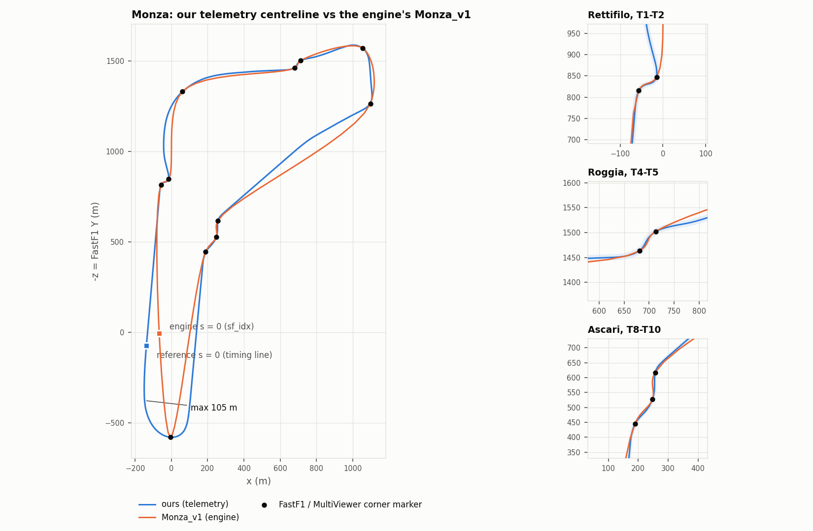
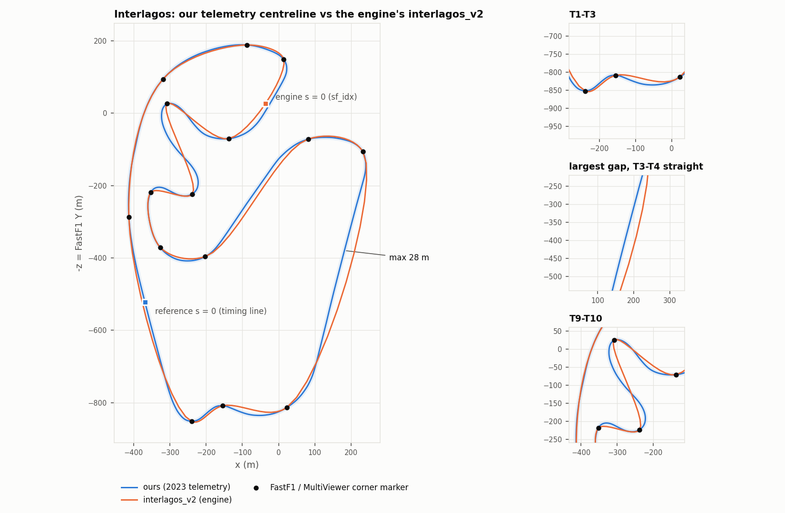
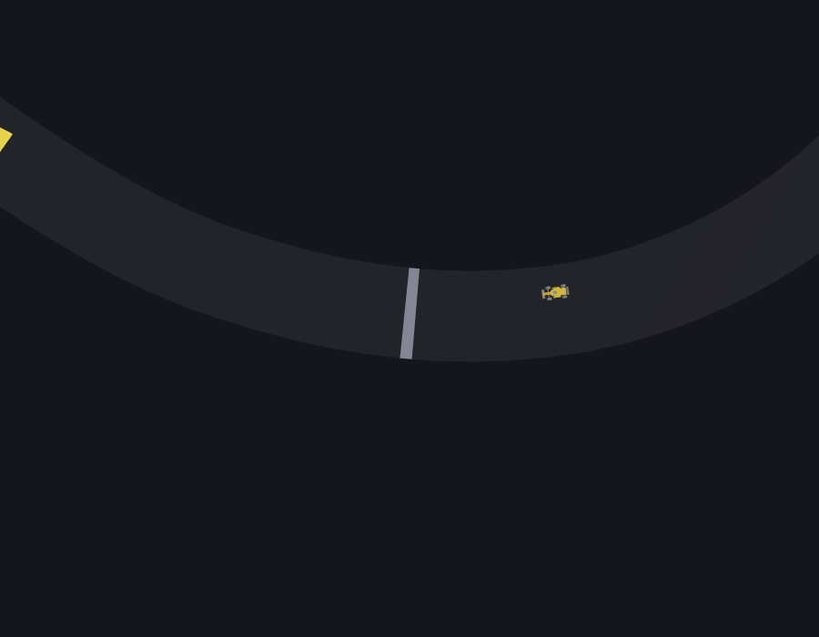

# Phase 0 — the engine's frozen tracks as the 3D geometry source

**Question.** The simulation engine (PyBullet + neural drivers, group repo branch
`feat/bot-ai`) drives on its own frozen tracks, `backend/model_train/tracks_frozen/`.
The group is leaning towards making those the single geometry source, which
means the 3D renders them instead of our telemetry centreline. This phase
produces evidence for that decision. Nothing in the group repo was modified.

**Short answer.** The frozen tracks are not a coarser version of the circuit. They
are a **spline through FastF1's corner markers**, reproduced here to 7×10⁻¹³ m.
They hit every corner marker exactly and are 20–100 m off the real circuit between
markers. Monza_v1's Hausdorff distance to our centreline is **105.5 m**. The
viewer renders them without code changes, but it renders their shape faithfully,
and that shape is not Monza.

**Phase 0b (2026-11-12): real Interlagos and Monza from FastF1 caches.** FastF1
is now pinned to the backend's 3.8.3 and always runs offline (§6b). Monza was
regenerated from our own cache. Its shape moved at most 0.50 m, but s = 0 moved
2.5 m along the track, and all checks still pass. Interlagos now has
**our own telemetry centreline**, extracted from the group's cache (2023 race,
dry, kept; 2024 race, wet, compared), with s = 0 at the timing line. Against it,
interlagos_v2's Hausdorff distance is **27.5 m**, and the MultiViewer stand-in's
27.45 m holds up as a cross-check (§6). Both Interlagos extractions are exported
in the engine's frozen format, and the backend's own `load_track_frozen`
accepts their hashes (§11). The engine smoke lap could not run on this machine
(no pybullet build for Windows / Python 3.11); the script is ready (§11).

Everything below is reproducible. Run it from `viz3d/` (Python env:
`requirements.txt`; npm deps: `npm ci`). `<cache>` is the group's FastF1 3.8.3
cache (outside the repo, never committed; read from a copy, see §6b), and
`<ours>` is our own Monza cache:

```bash
python scripts/extract_track.py --circuit monza --year 2024 --cache <ours>
python scripts/extract_replay.py --cache <ours>
python scripts/extract_track.py --circuit interlagos --year 2023 --start-finish timing-line \
    --cache <cache> --out public/tracks/interlagos.json
python scripts/extract_track.py --circuit interlagos --year 2024 --start-finish timing-line \
    --cache <cache> --out public/tracks/interlagos_2024.json
python scripts/convert_frozen_track.py --circuit monza --frozen vendor/tracks_frozen/Monza_v1.json \
    --corners-from public/tracks/monza.json --out public/tracks/monza_v1.json
python scripts/convert_frozen_track.py --circuit interlagos --frozen vendor/tracks_frozen/interlagos_v2.json \
    --corners-from-multiviewer --out public/tracks/interlagos_v2.json
python scripts/overlay_frozen.py --frozen-dir vendor/tracks_frozen   # -> docs/phase0/metrics.json + plots
npm run typecheck && npm test && npm run snapshot
python scripts/export_frozen_track.py --track public/tracks/interlagos.json \
    --name "São Paulo Grand Prix (viz3d 2023 race)" --out exports/interlagos_2023_v1.json
python scripts/export_frozen_track.py --track public/tracks/interlagos_2024.json \
    --name "São Paulo Grand Prix (viz3d 2024 race)" --out exports/interlagos_2024_v1.json
cd .. && python viz3d/scripts/verify_export_backend.py     # backend's own hash check
python viz3d/scripts/smoke_engine_lap.py                    # needs pybullet (§11)
```

`vendor/tracks_frozen/` holds byte-exact copies of
`backend/model_train/tracks_frozen/{Monza_v1,interlagos_v2}.json` from this
repo's branch `feat/bot-ai`, commit `cf6529f863`. Their blob ids and hashes are
in `vendor/tracks_frozen/PROVENANCE.md`. The two `--corners-from-multiviewer` /
overlay steps fetch MultiViewer's circuit data on first run and cache it under
`.cache/multiviewer/` (not committed; see ASSETS.md).

Re-run from the vendored copies on 2026-11-04: geometry, corners and
`docs/phase0/` (metrics and plots) came out byte-identical. The only part of the
two track JSONs that changes is the `source` block's git provenance
(`repo`/`branch`/`commit`/`path`/`gitBlob`/`dirty` now describe the vendored
copy, not `feat/bot-ai`), and for interlagos_v2 `fileSha256`, because the
committed value was hashed from a CRLF checkout (PROVENANCE.md explains). So keep
the committed `source` blocks: they record the true origin.

---

## 1. The frozen files, verified

| claim | verdict |
|---|---|
| `waypoints [[x, y]]` in metres, `width_m` 12.0 | ✅ |
| `sha256` | ✅ verifies on all four files inspected. It is **not** a file hash. It is the first 16 hex digits of `sha256(json.dumps(doc minus "sha256", sort_keys=True))`, as `load_track_frozen` computes it (`f1_env.py:1327`). The converter records both values. |
| waypoint 0 ≠ start/finish; `sf_idx` | ✅ Monza_v1 1268 (engine s 4819.89 m); interlagos_v2 729 (engine s 2655.16 m) |
| spacing non-uniform, max 4.0 m | ✅ Monza_v1 2.005–3.999 m, interlagos_v2 2.679–3.998 m. §3 explains why. |
| Monza_v1 = 5641.9 m | ✅ 5641.92 m |
| engine lateral is +left, ours +right | ✅ `_project_on_path` signs by `cross(segment, p − foot)` in the FastF1 (X, Y) plane, and `test_rl_v2.py:109` asserts "esquerda = positivo". So **`d_ours = −d_engine`**. Caveat: the engine measures against the **segment** normal, which is our `project_naive`, not the refined projector (§5). |
| engine uses the waypoints verbatim | ✅ `Track.from_waypoints` normalises the points and never resamples them |
| same frame as our `monza.json` | ✅ **Established.** All 11 FastF1 corner markers are vertices of Monza_v1 (§3), and a recorded lap in the FastF1 frame matches our centreline to 1.39 m (§4). The two lines differ in **shape**, not in frame. |

`interlagos_v1`, `_v2` and `_sf729_v2` share identical waypoints and the same
`sf_idx` (729). Only their metadata differs.

## 2. Conversion (`scripts/convert_frozen_track.py`)

- **Rotated, never resampled.** The loop is rolled so `sf_idx` becomes point 0, so
  `s = 0` is the engine's start/finish. The vertices are the engine's own,
  rounded to 6 decimals (micrometres). `frame.ts` does **not** assume uniform
  spacing: `s` is the cumulative chord length and segment lookup is a binary
  search. The `describe.each` seam test in `frame.test.ts` passes on both engine
  tracks at the new seam. Because nothing is resampled, the mapping is exact:
  `s_ours = (s_engine − engineSAtSfM) mod L` and `d_ours = −d_engine`. Both are
  recorded in each file's `source` block.
- `(X, Y) → (X, 0, −Y)`, asserted equal to `extract_track.to_three`.
  `widthM` 12.0 comes from the file. `year` is `null` because the file doesn't
  record one.
- **Corners.** For Monza_v1, each of our corners' points *on our centreline* is
  projected onto the frozen line with `centreline.project_global`. For
  interlagos_v2, MultiViewer's corner markers are projected (FastF1's
  `circuit_info` source; we had no Interlagos centreline before Phase 0b, §6). Every projection
  bracketed a segment. The residual `d` on Monza_v1 is 0.29–0.72 m, which is just
  the offset of our centreline from the markers.
- **No geometric gate.** It writes the file even when reference checks fail, since
  measuring those failures is the point. It refuses only on structural problems:
  a hash mismatch, a bad `sf_idx`, a duplicated closing vertex, or non-finite
  coordinates.
- Schema: track JSON gains a required `circuit` id (`"monza"`, `"interlagos"`).
  `reference.ts` is now keyed by that id, so `Monza_v1` is checked against the
  Monza facts whatever it is called (asserted in `tracks.test.ts`). The optional
  fields added are `variant`, `uniformSpacing`, `spacingMinM`/`MaxM` and `source`.
  `monza.json` was regenerated with the parameterised extractor and is identical
  apart from the new `circuit` key. (Phase 0b later regenerated it with FastF1
  3.8.3, §6b. The numbers in §3–§4 are re-measured on that version.)

## 3. The central finding: the frozen tracks are a spline through the corner markers

The group's `track_loader.py` builds tracks by Catmull-Rom through
`circuit_info.corners`. Four tests, each with its own output:

**(a) The markers are vertices.** All 11 MultiViewer/FastF1 corner markers are
vertices of Monza_v1 to **2.3×10⁻¹³ m**, at indices 0, 22, 153, 320, 339, 436, 523,
796, 823, 852, 1120. All 15 are vertices of interlagos_v2, to **1.1×10⁻¹³ m**.
Waypoint 0 is T1 in both, which is why "waypoint 0 is not the start/finish line".

**(b) The interpolant.** Closed Catmull-Rom through the markers, parameterised by
chord^α. Distance from every frozen vertex to the curve:

| α | Monza_v1 p50 / max (m) | interlagos_v2 p50 / max (m) |
|---|---|---|
| 0 (uniform, what `track.py::_catmull_rom_spline` on `feat/bot-ai` does) | 10.95 / 41.91 | 5.77 / 46.55 |
| 0.4 | 2.99 / 9.36 | 1.20 / 10.54 |
| **0.5 (centripetal)** | **0.20 / 2.53** | **0.15 / 1.59** |
| 0.6 | 4.01 / 13.21 | 1.60 / 12.95 |
| 1 (chordal) | 30.15 / 136.62 | 7.07 / 90.32 |

**(c) Exact reconstruction.** The ≤ 2.5 m left over at α = 0.5 is the sagitta of
straight pieces between sparse knots. The whole file is reproduced by:

1. centripetal Catmull-Rom through the markers, **12 samples per segment**,
   which is `track.py`'s `samples_per_segment` default. That gives 132 knots on
   Monza (11 × 12) and 180 on Interlagos (15 × 12);
2. each knot-to-knot chord split into **ceil(len / 4 m)** equal pieces. That is
   where the 2–4 m non-uniform spacing comes from.

Vertex for vertex: **1477/1477, max error 6.8×10⁻¹³ m** (Monza_v1) and
**1131/1131, 2.3×10⁻¹³ m** (interlagos_v2). The vertex-heading change is below
6×10⁻¹² ° at every non-knot vertex. The script that produced the files isn't on
`feat/bot-ai`, whose only Catmull-Rom is the uniform one, so this is a
reconstruction, not a citation (`overlay_frozen.py::reconstruct`).

**(d) Curvature against `s`** ([monza-curvature.png](phase0/monza-curvature.png),
[interlagos-curvature.png](phase0/interlagos-curvature.png)). The hypothesis
predicted peaks at the markers and non-zero curvature on the straights.

- **Peaks at the markers: confirmed.** On Monza_v1, 7 of 11 markers carry their
  local |κ| maximum (within ±50 m) exactly (≤ 0.2 m), T2 is within 2.6 m, and T4,
  T5 and T9 peak 7–40 m away. On interlagos_v2, 13 of 15 sit exactly. On **our**
  Monza centreline only T10 does (0.8 m) and T4 comes close (3.9 m); the other
  nine peak 6–47 m from their marker, because a fitted centreline peaks at the
  real apex, not at an annotation. Our Interlagos centreline behaves the same
  way: T4, T5 and T10 peak within 2.8–4.2 m, and the other twelve 5.8–49 m away.
- **Non-zero curvature on the straights: not as predicted.** Between knots the
  frozen line is exactly straight (κ ≈ 10⁻⁸ /m, from step 2 above). Its curvature
  is a train of spikes at the knots, which are 30 m apart at p50 and up to 166 m.
  The straights are still **not straight at the scale of the lap**. Deviation
  from the chord over our straight stretches:

| our straight (s, m) | length | ours | Monza_v1 |
|---|---|---|---|
| T11 Parabolica exit → T1 (main straight) | 1095 m | 7.9 m | **18.5 m** |
| T10 → T11 (Ascari → Parabolica) | 805 m | 0.7 m | **5.0 m** |
| Lesmo 2 → T8 Ascari | 560 m | 1.4 m | **7.2 m** |
| after Lesmo 2 | 265 m | 1.9 m | **7.7 m** |
| Curva Grande → Roggia | 320 m | 3.6 m | 2.0 m |

The same measurement on Interlagos, our 2023 centreline against interlagos_v2: the
straight from T3 into T4 (495 m) deviates 2.2 m from its chord on ours and
**18.1 m** on interlagos_v2. The main straight, T15 → T1 (395 m), deviates 3.9 m on
ours and **11.6 m** on interlagos_v2.

**(e) Kinks at the markers.** A spline forced through apex markers corners at
them. The largest single-vertex heading change is **120.4° on Monza_v1 at the T11
Parabolica marker** (s 5061.3, where |κ| reaches 0.250 /m, R 4.0 m) and **57.5° on
interlagos_v2 at T10** (R 6.7 m). Our centreline's largest is 15.9°.

## 4. Overlay — Monza ([monza-overlay.png](phase0/monza-overlay.png))



Point-to-polyline distance, both lines densified to 1 m. This is not the
projector's `d`, which assumes a nearby, well-conditioned foot point.

| | max | p50 | p90 | where the max is |
|---|---|---|---|---|
| ours → Monza_v1 | 105.47 m | 22.44 m | 74.98 m | our s 5451.7, Parabolica exit (T11 +268 m) |
| Monza_v1 → ours | 105.47 m | 19.53 m | 72.98 m | frozen s 5278.1 (T11 +217 m) |
| **Hausdorff** | **105.47 m** | | | |

- **Length.** Ours 5756.8 m, Monza_v1 5641.9 m: **−114.9 m**. Published 5793 m.
- **Corners.** Every corner is 69–122 m earlier on Monza_v1, because the shortage
  accumulates: T1 891.4 → 822.0 (−69.4 m), T3 −86.2, T4–T6 −90.0 to −90.8,
  T8–T10 −81.7 to −83.6, T11 5183.5 → 5061.3 (**−122.2 m**).
- **Start/finish.** The two `s = 0` points are **97.5 m apart**. Our s = 0 projects
  onto Monza_v1 at s **−63.7 m, d −73.8 m**. Monza_v1's s = 0 projects onto ours at
  s **+73.3 m, d +64.4 m**. The lateral component is the bowed main straight. Our
  s = 0 is within about a metre of the timing line: the replay's lap boundaries
  (check Q in `extract_replay.py`) average −1.0 m from it. MultiViewer's timed-lap
  start lands at −15.5 m (on Interlagos at +20.6 m, §6), so it marks the timing
  line only to ±20 m.
- **Chicanes** (zooms). Rettifilo and Roggia agree within a few metres *between*
  their two markers and diverge immediately outside them. Ascari follows the
  markers and cuts between them. The Rettifilo's left half is **not** smoothed
  away (check G passes, §7), contrary to the expectation going in.
- **Stand-in validation, used in §6.** MultiViewer's recorded lap (one 2021 FP1
  lap, 752 points, 6.8 m median step) against our centreline: **Hausdorff 1.39 m,
  p50 0.06 m, p90 0.47 m**. Against Monza_v1 it gives 105.76 m, the same picture
  as ours.

## 5. Projector preconditions on the frozen geometry

`centreline.brackets` relies on `f` being monotone on each segment, which needs
`cos α > |d κ|`. Those values were measured on our uniform 5 m Monza (cos α ≥ 0.990,
|d κ| ≤ 0.041). Re-measured:

| | min cos α | max \|d κ\| at half-width | monotone everywhere |
|---|---|---|---|
| ours | 0.990 | 0.041 | yes |
| Monza_v1 | **0.449** (at the T11 kink) | **1.498** | **no** |
| interlagos_v2 | 0.855 | 0.894 | **no** (T10) |

The corner projections above all bracketed: the lowest cos α at a projected corner
was 0.547 (T11). But "(s, d) ↔ world is an identity" (3d-design §6B) no longer
holds unconditionally at the kinks. The engine's own lateral is measured against
the segment normal, and on these files that differs from the interpolated-tangent
normal by up to acos(0.449) = 63° at Parabolica. So near a kink, `d_engine` and
our `d` are not just sign-flipped copies of each other.

## 6. Interlagos ([interlagos-overlay.png](phase0/interlagos-overlay.png))



**Phase 0b: our own centreline.** Phase 0 had no São Paulo telemetry (§6b
explains why). The group's FastF1 3.8.3 cache has both the 2023 race (dry) and
the 2024 race (wet, red flag). Both went through the **unchanged pipeline**:
same defaults as Monza (20 quick laps, 2000-point grid, 15-point Savitzky–Golay
window, which is 32 m here, 5 m spacing), with one added step that is off by
default.

**s = 0 at the timing line (step 6b, `--start-finish timing-line`).** The
default s = 0 is point 0 of the median lap: each lap's *first position sample*,
which lands a fraction of a sample past the line. How far past depends on the
session and the FastF1 version: it is what moved between 3.4.4 and 3.8.3 on Monza
(§6b), and it put the 2023 and 2024 extractions 6.5 m apart. Step 6b instead
takes every clean timed lap (step 2's filters without the quick-lap cut or the
per-driver cap, lap 1 excluded) and interpolates the car's position at its
`LapStartTime`, the instant it crossed the timing line, between the two
bracketing position samples. These are projected with the shared projector, and
the loop is rolled so that s = 0 is their median before step 7 resamples.

| | 2023 race (dry) | 2024 race (wet, red flag) |
|---|---|---|
| step 2 laps | 20 from 17 drivers, laps 17–68 | 20 from 18 drivers, mostly laps 59–69, a few 19–21 |
| worst / median lap deviation (check I) | 9.6 / 3.7 m | 13.6 / 5.2 m |
| length (check A, published 4309 m) | 4226.1 m, −1.92% | 4226.5 m, −1.91% |
| timed lap starts used | 980 | 939 |
| timing line vs first-sample s = 0 | −0.57 m | −1.79 m |
| per-lap scatter (MAD; p10..p90) | 3.1 m; −3.7..+7.9 m | 3.4 m; −4.8..+7.5 m |
| T1 | 365.3 m | 360.1 m |
| extraction checks A–K | 11/11 | 11/11 |
| viewer checks (§7) | A C E F pass; B D G not run | A C E F pass; B D G not run |

**The two years against each other.** Hausdorff distance **0.51 m** (p50 0.04 m,
p90 0.16 m): the same shape to within the pipeline's own noise. Their timing
lines are **5.3 m apart** along the track, so every corner of 2024 sits 4.8–5.2 m
earlier. The per-lap scatter (MAD ~3 m, about 0.04 s at straight-line speed) is
the position stream's timing jitter against `LapStartTime`. With ~950 laps the
median's statistical error is well under a metre, so the 5.3 m is a systematic
per-session offset between the position and timing clocks. **Read s = 0 as
"the timing line ± ~3 m"**, not surveyed.

**Kept: 2023.** It is a dry race with normal racing lines, and its laps scatter
less (median deviation 3.7 m vs 5.2 m, worst 9.6 m vs 13.6 m). The 2024 race was
run largely on a wet or drying track behind a red flag. Its clean laps come mostly
from the last ten laps, and wet lines are not the dry centreline. Geometrically
the choice hardly matters (0.51 m), so it comes down to which data is cleaner.
2023 is `public/tracks/interlagos.json` (`?track=interlagos`). 2024 stays in the
viewer as `?track=interlagos_2024`, as the second extraction this comparison
rests on, not as a second layout.

**Against interlagos_v2** (replacing the stand-in numbers):

| | max | p50 | p90 | where |
|---|---|---|---|---|
| ours → interlagos_v2 | 27.50 m | 5.14 m | 17.20 m | our s 1118.0: the straight from T3 into T4 (T4 −284 m) |
| interlagos_v2 → ours | 27.51 m | 4.94 m | 16.69 m | frozen s 2253.8 (T4 −286 m) |
| **Hausdorff** | **27.51 m** | | | |
| 2024 → interlagos_v2 (cross-check) | 27.48 m | 5.10 m | 16.99 m | same place |

- **Length.** Ours 4226.1 m, interlagos_v2 4160.4 m: **−65.6 m**. Published 4309 m:
  ours −1.92%, interlagos_v2 −3.45%.
- **Corners.** With the 1151 m start/finish offset removed (below), interlagos_v2's
  corners run 11 m early at T1, 24 m by T9, 52–58 m by T10–T11, and 70–73 m by
  T12–T15. The shortage accumulates from the engine's s = 0 the same way Monza's
  does (§4).
- **Start/finish.** Our s = 0 (the timing line) projects onto interlagos_v2 at
  **s = +1145.4 m** (d −7.2 m), and interlagos_v2's s = 0 onto ours at **−1151.0 m**
  (d −10.7 m). So the engine's `sf_idx` 729 is **~1150 m (27% of a lap) before
  the timing line**, between T11 and T12. That confirms Phase 0's stand-in figure
  (1166 m), which was 20 m too long because MultiViewer's lap starts 20.6 m past
  the line.
- **Curvature** ([interlagos-curvature.png](phase0/interlagos-curvature.png)). Ours
  is smooth, with a largest vertex turn of 15.2°. interlagos_v2 is spikes at its
  180 knots, with 57.5° at T10. The distance profile peaks on the T3–T4 straight
  (27.5 m) and in the infield after T9 (15–20 m).

**The MultiViewer stand-in, kept as a cross-check.** The recorded lap (driver 3,
2021 FP1 lap 2, 283 points, 13.9 m median step) against **our** centreline:
**Hausdorff 0.93 m**, p50 0.07 m, p90 0.27 m. Against interlagos_v2 it gave
**27.45 m** (p50 4.97 / 5.15 m, p90 16.74 / 16.90 m), and ours gives 27.51 m.
So Phase 0's Interlagos conclusions stand. Its polygon measured 4231.5 m, against
our 4226.1 m.

## 6b. FastF1 version and caches

**Phase 0's blocker.** F1's live-timing archive answers HTTP 401 without an F1
account. Phase 0 had only our own Monza cache (downloaded 2026-09-18 with
FastF1 3.4.4) and no São Paulo session. On 2026-11-05 it retried with FastF1
3.9.2: 3.9.2 tries to sign in, gets 401, falls back to `livetiming-mirror.fastf1.dev`,
gets 404, and raises `SessionNotAvailableError`. 3.9.2 also moved `monza.json` by up
to 2.75 m, so the venv went back to 3.4.4.

**Phase 0b: FastF1 3.8.3, offline.** The backend pins `fastf1==3.8.3` (F1 now
needs a login, and 3.8.3 is the version that wrote the group's cache).
`requirements.txt` follows it, and `extract_track.enable_cache` always calls
`Cache.offline_mode(True)` and refuses a cache directory that does not exist.
Nothing is fetched. Both caches live outside the repo, and both were read from
copies so that FastF1 could not write into the originals. 3.8.3 re-parses the
3.4.4 pickles from the raw HTTP responses in the cache's sqlite.

**Monza regenerated with 3.8.3, from our own cache.** All 11 extraction checks and
all 7 viewer checks pass, so the result is kept.

| | vs committed 3.4.4 `monza.json` |
|---|---|
| shape (point-to-polyline, both ways) | **max 0.50 m**, p50 0.02 m, p99 0.26 m |
| length | 5756.9 → 5756.8 m (−0.10 m) |
| s = 0 | moved **2.49 m** along the track |
| corners | all +2.4 to +2.7 m (T1 888.9 → 891.4 m) |
| index-for-index displacement | max 2.79 m, p50 2.67 m |

So the "2.75 m" that 3.9.2 produced was the same kind of number. Index for index,
it reads a 2.5 m shift of the lap's start sample as movement of the track. The
shape itself moves by half a metre. The replay (`monza-2024-race.json`) and the
round-trip fixture were regenerated against the new centreline, with all
10 replay checks passing. The replay's check Q puts the timing boundaries
1.0 m before the new s = 0. Monza keeps the default s = 0 (the unchanged
pipeline). Moving it to the timing line would shift it by about 1 m.

## 7. The seven checks

Run by the viewer's own `verify.ts`, against the external references in
`reference.ts`. Nothing was loosened. Results are pinned in
`src/track/expected-verdicts.json`, which `tracks.test.ts` and
`npm run snapshot` both read. A verdict that changes in either direction fails
both. Known failures print as XFAIL with their measured value.

| check | ours (Monza) | Monza_v1 | ours (Interlagos 2023) | ours (Interlagos 2024) | interlagos_v2 |
|---|---|---|---|---|---|
| A length vs published (±2%) | ✓ −0.62% | ✗ **−2.61%** (5641.9 vs 5793) | ✓ −1.92% (4226.1) | ✓ −1.91% (4226.5) | ✗ **−3.45%** (4160.4 vs 4309) |
| B corner count | ✓ 11 | ✓ 11 | – not run | – not run | – not run (no sourced count) |
| C corner order from T1 | ✓ | ✓ | ✓ T1 365 .. T15 3987 m | ✓ T1 360 .. T15 3982 m | ✗ **T12 first**: s order T12..T15, T1..T11 |
| D first corner (Monza 700–1050 m) | ✓ 891.4 | ✓ 822.0 | – not run | – not run | – not run (no sourced window) |
| E sense | ✓ clockwise | ✓ clockwise | ✓ anticlockwise | ✓ anticlockwise | ✓ anticlockwise |
| F one revolution | ✓ +1.001 | ✗ **+0.940** | ✓ +1.001 | ✓ +1.002 | ✓ +1.004 |
| G handedness (Monza RLRLRRRLRLR) | ✓ | ✓ **all 11** | – not run | – not run | – not run (no sourced handedness) |

- **Monza_v1 F.** The loop does turn exactly once: vertex headings sum to 1.0000
  revolution. `buildFrame` estimates curvature from neighbouring tangents and
  cannot represent a 120.4° turn inside one sample. The failure is therefore real
  information. The viewer's curvature, which also drives camera roll and check G,
  is wrong at Parabolica.
- **interlagos_v2 C.** This follows from §6: s = 0 sits after T11.
- **Our Interlagos A** passes with little room: −1.92% against a 2% tolerance,
  3.5 m inside it. Monza is −0.62%. Interlagos is twistier, so the median of racing
  lines plus smoothing shortens it more. The tolerance was not touched.
- **Interlagos references and their sources.** 4309 m for the 1999–present layout
  ([Wikipedia, "Interlagos Circuit"](https://en.wikipedia.org/wiki/Interlagos_Circuit)),
  and anticlockwise (the same page, plus
  [Ferrari's circuit page](https://www.ferrari.com/hypercar/sao-paulo)). Nothing
  else was sourced, so B, D and G show as *not run*, never as passed. Phase 0b
  ran the checks with these two references only: `circuit_info` supplies 15
  numbered corners, but that is the artefact's own data, not a reference.
- **A bug fixed along the way.** Check E's text named the direction *relative to*
  the reference, so on Interlagos it printed "−0.400 km² → clockwise". The
  pass/fail logic was correct; only the label was wrong, and it never showed on
  clockwise Monza.

## 8. Rendering (`npm run snapshot`)

All green: our Monza at 7/7 with both motion sources and the wheel check, and
Monza_v1, our two Interlagos and interlagos_v2 with the synthetic field (no
replay exists for them). The snapshot reaches each track after the first by
**clicking the viewer's own track picker**, so the selector is exercised too.
Phase 0b made that lookup match the `track` parameter exactly, because a
substring match for `interlagos` also hit `interlagos_2024` and `interlagos_v2`.
Non-background share, orbit / chase / T-cam: Monza_v1 0.55 / 26.80 / 28.47%,
Interlagos 2023 1.90 / 27.41 / 28.85%, interlagos_v2 1.78 / 19.85 / 25.94%.

Parabolica, same overhead camera on the T11 marker:

| ours | Monza_v1 |
|---|---|
|  |  |

On Monza_v1 the 12 m ribbon folds at the 120° vertex, and the corner stripe (a
1.6 m quad) smears into a wedge. Any car crossing that vertex has its heading
swung through it within one or two samples.

## 9. What the 3D loses by switching

Switching keeps the parts that are pure bookkeeping. The `(s, d)` model, `toWorld`
and the ribbon all work unchanged on non-uniform 2–4 m spacing. The `s`/`d`
mapping to the engine becomes exact: an offset and a sign. Corners sit exactly on
FastF1's markers, so corner order, count and handedness survive on Monza. What it
loses is the circuit's **shape between the corners**. The 3D would show a Monza
whose straights bow up to 18 m off their chord and sit up to 105 m from where the
cars really ran, and whose Parabolica is a 4 m-radius V on which the ribbon folds
and the camera's curvature model breaks (check F). The lap is 115 m short with
every corner 69–122 m early. Interlagos is 149 m short of the published length
(66 m short of our centreline), with corners up to 73 m early and a 27.5 m bow on
the straight from T3 into T4. Real telemetry could no longer be shown on the same
geometry. M6's replay would project onto this line with |d| up to about 100 m,
so the only data-driven validation the spike has (projection identity, speed bias
against FastF1's independent `Speed` channel to 0.4%) has nothing to run against.
Interlagos' `s = 0` would also be ~1150 m from the timing line. None of this is
the 3D's to fix: rendering the frozen tracks faithfully means rendering marker
splines faithfully.

## 10. Implications

Facts:

- The frozen tracks are deterministic functions of FastF1's corner markers (§3),
  and the engine's neural drivers were trained and evaluated on them.
  `PROJECT_STATE.md` on `feat/bot-ai` lists Monza and interlagos as **training**
  tracks.
- Per the same file (line 13), the drivers completed **3/3 laps zero-shot on
  Suzuka and on Spa**, neither of which was in training. The same file also
  records (line 564) that the cached Spa is **incomplete: 4352 m against an
  official 7004 m**.
- Our telemetry centreline for Monza exists, passes all seven checks, and is in the
  same frame as the engine's tracks (§1, §4). Since Phase 0b so does one for
  Interlagos, passing every check that has a sourced reference (§6, §7), and it
  is exported in the engine's own format with a hash the engine accepts (§11).

Questions for the engine owner. These are open, not conclusions:

1. Could the engine adopt our telemetry centrelines as its tracks **without
   retraining**? The zero-shot results suggest the drivers generalise to unseen
   layouts, but those layouts were themselves marker splines, one of them
   incomplete. Whether that carries over to a real centreline, with real straights
   and no 4 m kinks, is untested.
2. Is `sf_idx` 729 on Interlagos the timing line, a start (grid) line, or a
   training-specific anchor? It measures ~1150 m before the timing line (§6).
3. If the frozen tracks stay the source, are the corner kinks (120° at Monza
   T11, 57° at Interlagos T10) intended, or should the generator smooth through
   the markers rather than corner at them?

Until those are answered, the viewer keeps both. `?track=monza` and
`?track=interlagos` (with `?track=interlagos_2024`) are our telemetry
centrelines, and `?track=monza_v1` / `?track=interlagos_v2` are the engine's,
selectable from the checks panel.

## 11. Phase 0b: our Interlagos in the engine's format

**Export** (`scripts/export_frozen_track.py`, to `exports/`, never into
`backend/`). Both Interlagos extractions are exported, one file each, named
`<key>_v1.json` so that `load_track_frozen('<key>')` resolves them:

| | `interlagos_2023_v1.json` (kept) | `interlagos_2024_v1.json` |
|---|---|---|
| `name` | São Paulo Grand Prix (viz3d 2023 race) | São Paulo Grand Prix (viz3d 2024 race) |
| `n_wp` | 1057 | 1057 |
| spacing | 3.968–3.998 m (uniform; max 4 m) | 3.969–3.999 m |
| length | 4225.4 m (source 4226.1 m) | 4225.9 m (source 4226.5 m) |
| vertex cut, max / p99 | 0.25 / 0.15 m | 0.22 / 0.15 m |
| `sf_idx` | 0 (the timing line) | 0 |
| `width_m` | 12.0 | 12.0 |
| `sha256` | `fd914dde1a2fa8b5` | `61fbf22bd5e55cc9` |

- `waypoints` are `[[x, y]]` in metres in the FastF1 plan frame of the existing
  frozen files (`x = three.x`, `y = −three.z`), in the direction of travel.
- **Spacing.** Our centreline is uniform 5 m. It is resampled uniformly along its
  own polyline at L / ceil(L / 4 m). Every waypoint lies on the viewer's
  polyline, and only the vertex corners are cut, by at most 0.25 m. This is
  deliberately not finer: the rule-based controller smooths over 9 *waypoints*,
  so the grid spacing sets its smoothing length. ~4 m keeps it near
  interlagos_v2's 3.7 m mean.
- `sf_idx` 0. Our s = 0 is the timing line and resampling starts there.
  `sf_method` records how it was located, and `source` records the track
  file's sha256 and the pipeline. The engine tolerates extra keys (interlagos_v2
  carries `sf_method`, `sf_frac` and `sf_original_v1`), and the hash covers them.
- `sha256` is computed with `convert_frozen_track.engine_hash`, the same function
  Phase 0 verified the existing files with. The files are written ASCII-escaped:
  `load_track_frozen` reads with `Path.read_text()`, i.e. cp1252 on Windows, which
  would mis-decode a raw UTF-8 "ã" and change the hash.

**Hash proven with the backend's own function** (`scripts/verify_export_backend.py`,
run from the repo root). It calls `backend.domain.track_resolution.load_track_frozen(key,
strict=True)` unchanged, with its module-level `FROZEN_TRACKS_DIR` pointed at
`viz3d/exports/` for the call. Both files load, with hash, `n_wp`, `sf_idx` and
`width_m` as written. A copy with one coordinate changed by 1 mm is refused
(`PISTA FROZEN CORROMPIDA … esperado fd914dde1a2fa8b5 mas calculado 4d1…`), so
the check is real.

**Engine smoke test: written, not run here.** `scripts/smoke_engine_lap.py`
builds a `Track` from each export with `load_track_frozen`, as above. It drives
exactly the backend's own clean-lap test
(`test_rule_based_race_controller_clean_lap_interlagos`): VER, Red Bull specs,
dry weather, `SimulationConfig(num_laps=1, logic_step_hz=10, physics_sub_steps=24,
gui=False, random_seed=42)`, `place_grid`, `RuleBasedRaceController(seed=42)`,
0.1 s ticks to lap 1. It reports lap time, max |lateral deviation| and edge
samples next to the same run on interlagos_v2, which
`backend/engine/racing_lines/README.md` ("Ritmo de volta") reports as **112.7 s,
max 4.32 m**. It could not run on this machine: pybullet publishes only Linux
wheels, building it on Windows needs the MSVC build tools, and there is no
WSL, Docker or conda here. The backend's `requirements.txt` also omits two
imports the engine needs, `joblib` and `gymnasium`.

**Expect the Interlagos tuning to stay off on the new geometry.** The
controller's Interlagos-specific values (lateral factor 0.65, 10 m/s², the local
racing line from `racing_lines/interlagos_rule_line.json`) activate only when
the sha256 of the waypoint array equals `INTERLAGOS_GEOMETRY_SHA256`, which is
interlagos_v2's. The exports therefore run on the conservative defaults (0.58,
6 m/s²). The closest baseline is therefore the README's **126.1 s**, the same
run on interlagos_v2 with these defaults before the tuning. 112.7 s is the tuned
figure, and 116.2–118.1 s is 0.58 with 10 m/s². The script prints which values
were active for each track.
